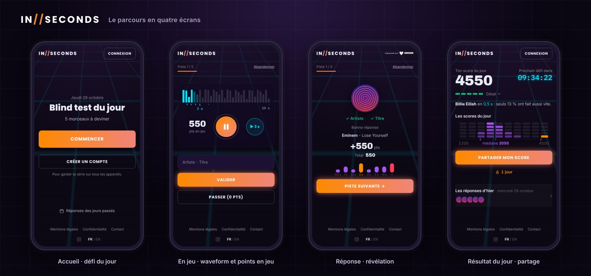

[🇫🇷 Lire en français](README.fr.md)

# InSeconds 🎵

**▶ Play now: [https://inseconds.cc](https://inseconds.cc)**

[](https://github.com/Oasis35/InSeconds/actions/workflows/ci.yml)



> Daily music blind test. Listen as briefly as you can, guess artist + title. Less time = more points. Same challenge for everyone, every day.

## How it works

- Each day at midnight UTC, a new set of tracks is automatically selected (only tracks with an active Deezer preview, outside a reuse cooldown that follows the pool size: a configurable share of the playable pool stays blocked); if the midnight job fails, the challenge is regenerated automatically when the first player arrives (deterministic selection: same challenge for everyone)
- Preview availability is re-checked nightly against Deezer (rate-limit aware, batched calls), along with the genres of each track's album (one call per album); admins can also re-run it on demand from the scheduled-jobs dashboard (`/jobs`)
- Playback starts automatically at the shortest step (0.5s); extend step by step (1, 1.5, 2, 3, 5, 10s) with "listen more" before attempting artist + title
- Free, unlimited "listen more" extensions per track (up to the last duration tier) - scoring is always based on the final tier listened, no penalty for extending
- The player shows the clip's real waveform (computed once per clip on the server and kept as about 2 KB of numbers, never any audio) and the points at stake, which drop as you extend or take a hint; the play button pulses with the bass
- A "Skip (0 pts)" button (with confirmation) moves on to the next track without answering
- Optional hints (release year, then a masked artist name) unlockable at 5s/10s of listening - costs points, server-authoritative
- Scoring is entirely server-side - no client-side manipulation possible
- On each reveal, see a histogram of how long other players needed to guess that track
- Guest mode: play without signing up (only the anonymous global stats of the day; friend groups and the Survie general ranking need an account)
- Optional linked accounts (open signup, passwordless magic-link login) - keeps history/streak across devices; guest play stays fully open regardless
- Daily streak shown under the Start button (details panel on tap), with streak freezes for linked accounts (1 free on signup, +1 every 7 days, 2 max, used automatically on a missed day)
- After playing, a single "today's result" screen: your score with your game as five small bars, the countdown, one line under the score (your standout moment when there is one, otherwise the share of players you beat, from 5 players), an equalizer of today's scores (lowest, median, highest), your tracks folded away
- On the home page, under today's challenge, a friends card: who in your group has played today (no scores) until you finish your own challenge, then the top of the day in your group; a guest or an account without a group can create one from there
- Share your score (one line per track: ✅ / ❌ for the artist, then the title, and the listening time), starting with the score, name and date, through the phone's share menu (clipboard on a computer)
- Available in French and English - auto-detected from the browser, switchable anytime from the footer (choice saved in localStorage)
- Legal notice at `/legal` (also `/mentions-legales`) and privacy policy at `/privacy` (also `/confidentialite`)
- Installable on the home screen (PWA), updated automatically at a safe moment (never in the middle of a round)
- List of the devices signed in to your account, sign out one device or all the others
- Your data (GDPR): download a JSON copy of all your data and permanently delete your account ("Your data" section of the profile); devices unseen for 91 days and accounts inactive for 3 years are deleted automatically every night; what you type as an answer is never stored
- Survie mode (`Runs` in the code, invitation-only for now): you chain rounds of 3 tracks, less and less well known, until you lose your 3 lives or finish the 8th round ("complete Series", with a bonus per remaining life); a round without a lost life gives one back and shortens the listening time (10, 5, 3, 2, 1, 0.5 s), a round with a lost life keeps it the same; a found track earns the points of its step, 45 s per track to answer, a theme to pick for each round from the 2nd; send the same playlist to friends with a link, beat their ghost and compare scores once you have played it
- Around Survie: a level shown as a disc (seven discs, from Scratched to Diamond), friend groups with their own ranking, a general ranking by level for the accounts that have access (under your pseudo or a musical alias), Hits (milestones earned by playing) and the history of your games (`/survie`; rules, screens and design in [`docs/runs/`](docs/runs/README.md))

## Quick start

### Prerequisites

- Docker (dev PostgreSQL database, and integration tests)
- .NET 10 SDK
- Node.js 24 (24.15 or later, required by Angular CLI 22.2) and npm

### Run the database and the API

```bash
cp .env.example .env   # first time only, then fill in DB_PASSWORD
docker compose up -d database

cd src/back
ConnectionStrings__DefaultConnection="Host=localhost;Port=5432;Database=inseconds;Username=inseconds;Password=<DB_PASSWORD>" \
  dotnet run --project InSeconds.Api.Testing
```

`InSeconds.Api.Testing` is the API with a fake Deezer, a fake email sender and the `/api/e2e/*` routes (never in the production image); `InSeconds.Api` is the real API. Migrations are applied at startup.

### Run the frontend

```bash
cd src/front/InSeconds.Client
npm ci        # first time only
npm start
```

Open `http://localhost:5176`.

### Useful URLs

| URL | Purpose |
|-----|---------|
| `http://localhost:5176` | Frontend (Angular dev server, proxies `/api` to the API) |
| `http://localhost:5175/health` | API liveness - also returns the build date (`build`) |
| `http://localhost:5175/health/ready` | API readiness (database reachable) |
| `http://localhost:5175/jobs` | Hangfire dashboard for scheduled jobs (admin account) |

## Stack

| Layer | Tech |
|-------|------|
| Backend | .NET 10, modular monolith (Players, Catalogue, Gameplay, Daily, Runs, Social), Wolverine (HTTP endpoints, transactions, outbox), FluentValidation, EF Core 10, Hangfire |
| Database | PostgreSQL 17, one schema per module (Docker in dev, shared Postgres container on the VPS in production) |
| Frontend | Angular 22 (standalone, zoneless, signals), NgRx SignalStore, Tailwind CSS v4, HTML audio element, PWA |
| Music | Deezer API (search, 30s previews, covers) |
| Tests | xUnit v3 + Testcontainers, NetArchTest, Vitest (browser mode), Sheriff, Playwright |
| Observability | OpenTelemetry (OTLP logs, traces, metrics) → Grafana Cloud; frontend errors relayed through the API; error code shown to the player |
| Deployment | OVH VPS (Debian), Docker Compose behind Caddy and Cloudflare, GitHub Actions CI/CD |

## Repository structure

```
InSeconds/
├── deploy/                    # VPS: shared Postgres and backups, Caddy, deploy scripts, Grafana dashboards
├── docs/                      # Documentation (FR): entry point, game rules, tasks, architecture, operations, compliance, Survie mode, history
├── src/
│   ├── back/                  # InSeconds.slnx: Api (modules), Infrastructure, Deezer, Waveform, Api.Testing, tests/
│   └── front/InSeconds.Client/  # Angular app (account, gameplay, daily, runs, social, admin domains)
├── docker-compose.yml         # Dev: database
├── docker-compose.staging.yml # Staging
├── docker-compose.prod.yml    # Production
└── README.md / README.fr.md
```

## Continuous integration

A GitHub Actions workflow runs on every push: backend, frontend, NSwag clients, nginx headers and end-to-end tests, only for the areas a branch changes (everything on `main` and `env/staging`).
The **"CI OK"** check aggregates them and is the one branch protection requires. Jobs, and what to do when one fails: [`docs/exploitation/ci.md`](docs/exploitation/ci.md).

Delivery: pull requests target `env/staging`, which is deployed to the staging site once "CI OK" passes; after testing there, `env/staging` is merged into `main` (merge commit), which deploys production the same way. Details: [`docs/exploitation/deploiement.md`](docs/exploitation/deploiement.md).

## Testing

### Backend

```bash
cd src/back
dotnet test --solution InSeconds.slnx   # unit + architecture + integration (Docker required)
```

Four projects in `tests/`: unit (domain rules, no database), architecture (module boundaries, NetArchTest), integration (Testcontainers: a real PostgreSQL with a fresh database per test class, the API in memory) and the VPS scripts (`deploy/vps` SQL scripts, `deploy/infra` backup scripts).

### Frontend

```bash
cd src/front/InSeconds.Client
npx ng test --watch=false   # Vitest in a real Chromium
npm run lint:arch           # domain boundaries (Sheriff)
```

### E2E (Playwright)

```bash
cd src/front/InSeconds.Client
E2E_DB_CONNECTION="Host=localhost;Port=5432;Database=inseconds_e2e;Username=inseconds;Password=<DB_PASSWORD>" npm run e2e
```

`playwright.config.ts` starts the test host (port 5177) and `ng serve` (port 5178). The specs cover the game, login, profile, devices, your data, streak and freezes, Survie, groups, admin…

## Documentation

The detailed docs are in French.

- [`docs/README.md`](docs/README.md) - entry point: where to find what
- [`CLAUDE.md`](CLAUDE.md) - hard rules, conventions, data model, index of known pitfalls (read before contributing)
- [`src/back/CLAUDE.md`](src/back/CLAUDE.md) and [`src/front/CLAUDE.md`](src/front/CLAUDE.md) - commands, structure, recipes and tests of each side
- `.claude/rules/` - the knowledge of each module, frontend domain and the deployment, as path-scoped rules: each file declares its `paths` and is loaded only when a matching file is touched (settings table in `back/reglages.md`)
- [`docs/architecture/`](docs/architecture/) - decisions, module boundaries
- [`docs/regles-du-jeu.md`](docs/regles-du-jeu.md) - game rules (scoring, extensions, anti-cheat, streak) - what is actually enforced vs merely configured
- [`docs/exploitation/`](docs/exploitation/) - VPS deployment, staging, backups, CI, emergency access
- [`docs/conformite/`](docs/conformite/) - Deezer API terms, GDPR
- [`docs/runs/`](docs/runs/README.md) - the Survie mode (rules, screens, design, what is left)
- [`docs/taches.md`](docs/taches.md) - what is left to do
- [`docs/historique/`](docs/historique/) - the project's history

## License

[PolyForm Noncommercial 1.0.0](LICENSE) - free to use, modify and distribute for any noncommercial purpose (personal, educational, hobby, research). Commercial use requires a separate agreement with the author.

## Contact

<contact@inseconds.cc>
