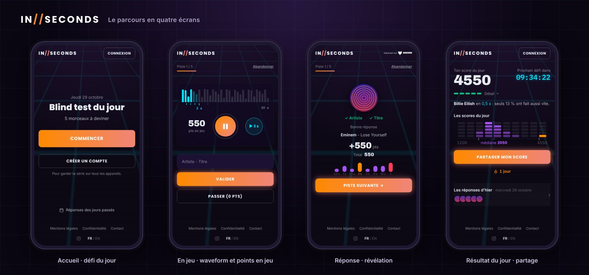

[🇫🇷 Lire en français](README.fr.md)

# InSeconds 🎵

**▶ Play now: [https://inseconds.cc](https://inseconds.cc)**

[](https://github.com/Oasis35/InSeconds/actions/workflows/ci.yml)



> Daily music blind test. Listen as briefly as you can, guess artist + title. Less time = more points. Same challenge for everyone, every day.

## How it works

- Each day at midnight UTC, a new set of tracks is automatically selected (only tracks with an active Deezer preview, outside a configurable reuse cooldown); if the midnight job fails, the challenge is regenerated automatically when the first player arrives (deterministic selection: same challenge for everyone)
- Preview availability is re-checked nightly against Deezer (rate-limit aware, batched calls); admins can also re-run it on demand from the scheduled-jobs dashboard (`/jobs`)
- Playback starts automatically at the shortest step (0.5s); extend step by step (1, 1.5, 2, 3, 5, 10s) with "listen more" before attempting artist + title
- Free, unlimited "listen more" extensions per track (up to the last duration tier) — scoring is always based on the final tier listened, no penalty for extending
- A "Skip (0 pts)" button (with confirmation) moves on to the next track without answering
- Optional hints (release year, then a masked artist name) unlockable at 5s/10s of listening — costs points, server-authoritative
- Scoring is entirely server-side — no client-side manipulation possible
- On each reveal, see a histogram of how long other players needed to guess that track
- Guest mode: play without signing up (no leaderboard, only global stats)
- Optional linked accounts (open signup, passwordless magic-link login) — keeps history/streak across devices; guest play stays fully open regardless
- Daily streak shown in the header (details panel on click), with streak freezes for linked accounts (1 free on signup, +1 every 7 days, 2 max, used automatically on a missed day)
- After playing, see where you stand: an equalizer of today's scores with the lowest, median and highest score, plus the share of players you beat (from 5 players)
- Share your score in Wordle-style emoji format via the clipboard
- Available in French and English — auto-detected from the browser, switchable anytime from the footer (choice saved in localStorage)
- Privacy policy and legal notice at `/privacy` (also `/confidentialite`)
- Installable on the home screen (PWA), updated automatically at a safe moment (never in the middle of a round)
- List of the devices signed in to your account, sign out one device or all the others

## Quick start

### Prerequisites

- Docker (dev PostgreSQL database, and integration tests)
- .NET 10 SDK
- Node.js ≥ 22.22 and npm

### Run the database and the API

```bash
cp .env.example .env   # first time only, then fill in DB_PASSWORD
docker compose up -d database

cd src/back
ConnectionStrings__DefaultConnection="Host=localhost;Port=5432;Database=inseconds;Username=inseconds;Password=<DB_PASSWORD>" \
  dotnet run --project InSeconds.Api.Testing
```

`InSeconds.Api.Testing` is the API with a fake Deezer, a fake email sender and the `/api/e2e/*` routes (never in the production image); `InSeconds.Api` is the real API. Migrations are applied at startup.

### Run the frontend

```bash
cd src/front/InSeconds.Client
npm ci        # first time only
npm start
```

Open `http://localhost:5176`.

### Useful URLs

| URL | Purpose |
|-----|---------|
| `http://localhost:5176` | Frontend (Angular dev server, proxies `/api` to the API) |
| `http://localhost:5175/health` | API liveness — also returns the build date (`build`) |
| `http://localhost:5175/health/ready` | API readiness (database reachable) |
| `http://localhost:5175/jobs` | Hangfire dashboard for scheduled jobs (admin account) |

## Stack

| Layer | Tech |
|-------|------|
| Backend | .NET 10, modular monolith (Players, Catalogue, Gameplay, Daily), Wolverine (HTTP endpoints, transactions, outbox), FluentValidation, EF Core 10, Hangfire |
| Database | PostgreSQL 17, one schema per module (Docker in dev, shared Postgres container on the VPS in production) |
| Frontend | Angular 22 (standalone, zoneless, signals), NgRx SignalStore, Tailwind CSS v4, HTML audio element, PWA |
| Music | Deezer API (search, 30s previews, covers) |
| Tests | xUnit v3 + Testcontainers, NetArchTest, Vitest (browser mode), Sheriff, Playwright |
| Observability | OpenTelemetry (OTLP logs, traces, metrics) → Grafana Cloud; frontend errors relayed through the API; error code shown to the player |
| Deployment | OVH VPS (Debian), Docker Compose behind Caddy and Cloudflare, GitHub Actions CI/CD |

## Repository structure

```
InSeconds/
├── deploy/                    # VPS: shared Postgres, Caddy, deploy scripts
├── docs/                      # Documentation (FR): entry point, game rules, tasks, rewrite plan
├── src/
│   ├── back/                  # InSeconds.slnx: Api (modules), Infrastructure, Deezer, Api.Testing, tests/
│   └── front/InSeconds.Client/  # Angular app (account, gameplay, daily, admin domains)
├── docker-compose.yml         # Dev: database
├── docker-compose.staging.yml # Staging
├── docker-compose.prod.yml    # Production
└── README.md / README.fr.md
```

## Continuous integration

GitHub Actions workflow on every push (all branches) and every PR to `main`:

- **back** — build, unit, architecture and integration tests (Testcontainers), migrations up to date, Wolverine codegen up to date, Docker image without the test host
- **front** — production build, Vitest tests, Sheriff boundaries, NSwag clients up to date
- **e2e** — Playwright against the test host
- **nginx-headers** — builds the frontend nginx image and checks cache and security headers, MIME types and the old-address redirect

The **"CI OK"** check aggregates them (it is the one branch protection requires). Stale runs are cancelled automatically. Details: [`CLAUDE.md`](CLAUDE.md) § CI.

## Testing

### Backend

```bash
cd src/back
dotnet test --solution InSeconds.slnx   # unit + architecture + integration (Docker required)
```

Four projects in `tests/`: unit (domain rules, no database), architecture (module boundaries, NetArchTest), integration (Testcontainers + Respawn: a real PostgreSQL, the API in memory) and the SQL scripts run by hand on the VPS (`deploy/vps`).

### Frontend

```bash
cd src/front/InSeconds.Client
npx ng test --watch=false   # Vitest in a real Chromium
npm run lint:arch           # domain boundaries (Sheriff)
```

### E2E (Playwright)

```bash
cd src/front/InSeconds.Client
E2E_DB_CONNECTION="Host=localhost;Port=5432;Database=inseconds_e2e;Username=inseconds;Password=<DB_PASSWORD>" npm run e2e
```

`playwright.config.ts` starts the test host (port 5177) and `ng serve` (port 5178). **120 tests** across 30 files, game, login, profile, streak and freezes, admin…

## Documentation

The detailed docs are in French.

- [`docs/COMMENCE_ICI_FR.md`](docs/COMMENCE_ICI_FR.md) — entry point: pitch, stack, where to find what
- [`CLAUDE.md`](CLAUDE.md) — conventions, data model, deployment, known pitfalls (read before contributing)
- Architecture: [`src/back/CLAUDE.md`](src/back/CLAUDE.md) (backend), [`src/front/CLAUDE.md`](src/front/CLAUDE.md) (frontend)
- [`docs/GAMEPLAY_RULES_FR.md`](docs/GAMEPLAY_RULES_FR.md) — game rules (scoring, extensions, anti-cheat, streak) — what is actually enforced vs merely configured
- [`docs/TACHES.md`](docs/TACHES.md) — what is left to do
- [`docs/refonte-v2/`](docs/refonte-v2/) — v2 plan and tracking

## License

[PolyForm Noncommercial 1.0.0](LICENSE) — free to use, modify and distribute for any noncommercial purpose (personal, educational, hobby, research). Commercial use requires a separate agreement with the author.

## Contact

<contact@inseconds.cc>
