# Survie : les écrans

Format : téléphone d'abord (390 × 844). Les textes sont dans les traductions (`runs.*`, `social.*`, FR et EN). Ce document décrit ce que voit le joueur ; les règles sont dans [`regles.md`](regles.md), seule source.

## L'interface Survie

La coque (barre du bas, accueil, historique du défi, classements des groupes) est la même pour tous ; un compte qui a l'accès au mode y voit en plus ce qui touche la Survie : c'est le seul drapeau, il n'y en a pas d'autre. Sans l'accès, rien de la Survie ne s'affiche, sans trous.

- **Barre du bas** à 4 entrées : Jouer (l’accueil), Groupes, Historique, Profil (« Connexion » pour un invité). Elle est masquée pendant une manche et sur les écrans de jeu. L'en-tête garde le logo, Instagram et, pour un admin, le cadenas ; le compte n'y est plus.
- **Accueil « ta journée »** (`/`) : des cartes pleine largeur, le défi du jour, la carte amis (pour tous, cf. [`regles-du-jeu.md`](../regles-du-jeu.md#les-groupes)) puis la Survie. La carte Survie montre le niveau (« Niveau Argent · 2 340 pts » ou « Pas encore de disque ») et l'échelle des 7 disques, avec au-dessus, la semaine qui précède une baisse, l'alerte cyan d'inactivité (« Ton disque d'argent baisse dans 3 jours »). La prochaine action est en orange : tant que le défi du jour reste à jouer, c'est lui. Un défi d'ami reçu s'affiche en bandeau violet dans la carte Survie ; la place « 2e dans Potes · 14e au général » s'y lit une fois, sous le niveau. Mentions légales, confidentialité et contact en ligne discrète sous la carte Survie.
- **Résultat du défi du jour** : une carte Survie sous le relevé de série.
- **Historique** (`/history/daily` et `/history/survie`, reliés par deux onglets) : pour le défi du jour, le défi d'aujourd'hui, la carte « Ton profil d'oreille », le calendrier du mois (une case par jour, teintée selon le score, qui mène aux réponses du jour) et « À réécouter » (détail : [`regles-du-jeu.md`](../regles-du-jeu.md)) ; pour la Survie, le résumé de toutes ses parties (nombre, moyenne, record), puis un mois à la fois avec les flèches, une ligne par partie (manches, jour, score) qui ouvre ses morceaux par manche (`/history/survie/<partie>` : « Tous / Ratés », ▶ pour réécouter un extrait). Toujours ses propres parties, jamais celles d'un autre.
- **Classements** (`/ranking`, pour tous les comptes) : une pastille par groupe, « + Groupe » et, avec l'accès Survie, « Général ». Le groupe choisi a deux onglets, « Cette semaine » (rang, pseudo, points des 7 derniers jours et sept points pour les jours joués) et « Aujourd'hui » (le score du jour ; tant que le joueur n'a pas fini son défi, seulement qui a joué et « Jouer le défi du jour »), les mêmes avec ou sans l'accès Survie. Sa ligne en orange, « pas encore joué » sans rang ; « Inviter un ami » (le lien d'invitation, par le menu de partage du téléphone ou le presse-papier) et « Quitter le groupe ». Seul dans son groupe : « Tu es seul dans Potes » et « Inviter un ami ». Sans groupe : « Joue contre tes amis » et « Créer un groupe ». Invité : « Créer un compte » (un groupe exige un compte).
- **Classement général** (`/ranking?view=general`) : une seule carte, les 20 premiers puis sa place et ses deux voisins, et une ligne fixe « Tu apparais sous Léa · Modifier » qui ouvre le choix entre le pseudo et un alias musical. Une ligne du profil y mène.
- **Créer un groupe** (`/ranking/new`) : un nom, trois étapes d'une ligne, « Créer et inviter » qui ouvre le partage du téléphone avec le lien.
- **Invitation** (`/ranking/join/<code>`) : le nom du groupe et ses places, « Rejoindre » pour un compte, la connexion sinon (l'invitation est gardée dans le navigateur et proposée après la connexion, à la fin d'une partie et sur le classement).
- **Hits** (`/survie/hits`) : la liste des 17 jalons, ceux obtenus en couleur. Un Hit obtenu depuis la dernière visite arrive avec un temps fort. La ligne « Hits 4 / 17 » est sur l'accueil du mode et la fin d'une partie.

## Repris du défi du jour, sans le refaire

Un écran qui existe déjà au défi du jour se reprend tel quel, seuls les textes changent (composants dans `gameplay/ui`) :

| Situation | Écran repris | Adaptation |
|---|---|---|
| Lecteur | `RoundPlayerComponent` | écoute d'un seul tenant, durée du palier, ↺ libre, ni « écouter plus » ni indice |
| Saisie | champ avec autocomplétion de la manche | « Artiste - Titre », Valider, « Passer (une vie) » avec confirmation en ligne (« Tu perdras une vie ») |
| Reprise d'une partie en cours | `resume-screen` | avertissement d'abandon : « Cette partie sera perdue et ne comptera pas pour ton record. » |
| « Abandonner » (lien de l'en-tête) | `ModalService.confirm` | même texte |
| Quitter la page en jouant | `leave-game.guard` | la partie se reprend plus tard |
| Extrait illisible | phase `audio-error` | « Réessayer / Passer » |
| Erreur avec code, pool trop petit, service indisponible | `status-screen`, overlay commun | textes `runs.*` |

Sans écran du tout : `/survie` sans accès (renvoie au défi du jour) et le lien d'une playlist déjà jouée (directement la comparaison).

## Le fil d'une partie

1. **Accueil du mode** (`/survie`) : la carte du niveau (disque, points, jauge, « Disque d'or dans 220 pts ») et l'échelle des disques, le record, la reprise d'une partie en cours, l'étagère des disques gagnés, la ligne « Hits ». « Commencer » recouvre le cadre de la partie (flou derrière) à l'arrivée directe ; « Jouer » de la carte de l'accueil lance le son et la partie d'un seul toucher.
2. **Manche** : un seul écran en pile.
   - **En-tête** : le logo « IN//SECONDS » à gauche et « Abandonner » à droite, comme au défi.
   - **Bloc du haut** (`run-scoreboard`) : trois zones : « Manche N » et une pastille par morceau de la manche (trouvé, à moitié, raté, retiré, en cours, à venir) à gauche, le score avec les bonnes réponses d'affilée au centre, les **vies** en cœurs rouges (3) à droite, pour qui joue la playlist d'un ami son **fantôme** (son pseudo, son total au même morceau, l'écart ; « Tu viens de dépasser Léa ! » quelques secondes au moment du dépassement ; « Tu bats Léa » au-delà de son score figé), et la rangée des paliers d'écoute (10 à 0,5 s) avec celui de la manche en ambre (repliée sur un écran bas, le clavier ouvert).
   - **Carte du morceau en cours** : bouton ↺ à gauche de la forme d'onde, le **thème** de la manche (l'indice) en pastille juste au-dessus de la saisie quand il y en a un, la saisie, Valider, « Passer (une vie) » (lien souligné sous Valider, la confirmation dit qu'une vie sera perdue). Le **chrono de 45 s** s'affiche en gris, les 5 dernières secondes en grand et en blanc avec un tic ; à 0 la réponse tapée part seule.
   - **La pile** dessous : les morceaux joués, avec la ligne de chaque manche passée.
3. **Réponse** : dans la carte, pochette ronde, artiste et titre avec ✓/✗ (une moitié juste en demi-teinte), « Une vie en moins » pour un morceau raté, points du morceau qui s'envolent vers le score, badge Deezer. Enchaînement au clic ou seul après 2 s.
4. **Morceau retiré** : quand Deezer n'a plus d'extrait, la carte devient « Morceau retiré de la manche » ; aucune vie perdue.
5. **Bilan de manche** (écran `palier`) : après chaque manche terminée avec au moins une vie : le score de la manche, le palier qui change en grand (« 5 s → 3 s »), ce que vaut désormais un morceau trouvé (« 200 → 350 pts »), « L'écoute raccourcit » ou « L'écoute reste la même », les vies restantes, « Vie regagnée » (ambre) quand la manche en rend une, et « Manche suivante » (« Choisir le thème » quand un choix suit).
6. **Choix du thème** (si le serveur en offre un, à partir de la manche 2) : « Choisis ton thème », deux thèmes (avec leur icône) et « Thème mystère » (tirage décoratif de 1,4 s, rien en mouvement réduit) ; le premier morceau part au clic.
7. **Fin** : dès la troisième vie perdue, après la 8e manche (« Série complète » à la place du nombre de manches, avec dessous le détail des bonus en ambre : vies restantes × 250 et complétion 500) ou un abandon. Le disque du niveau et ce que la partie a changé, le score en grand, « Nouveau record » ou le record, le nombre de manches passées, une case par manche, le duel de l'ami en première ligne s'il a fini la playlist, « Rejouer » (« Revanche » en duel) en action principale (sauf si le défi du jour reste à jouer : sa carte cyan passe au-dessus et « Rejouer » devient un contour), « Partager mon score » (grille d'emojis par manche, le palier, le score, « Fais mieux » vers la même playlist), « Défier un ami » et « Voir les autres joueurs », puis « Tes groupes » (une ligne par groupe avec sa place, « Tu passes devant Léa », ou « Joue avec tes amis · Créer un groupe ») et la ligne « Hits ». La fin se joue en 2,2 s (un toucher la saute).
8. **Défier un ami** : trois choix d'une phrase chacun, « Défier un ami » (le lien de la playlist), « Inviter dans un groupe » (le lien de la playlist qui fait aussi rejoindre le groupe ; « Créer un groupe et inviter » sans groupe), « Ma grille » (les emojis, sans lien). Quand la grille est copiée, le bouton dit « Score copié » et un toast le confirme.

Les sons d'interface (manche passée, fin, record, tic du chrono) sont synthétisés, jamais pendant un extrait, sans bouton pour les couper (on écoute de la musique pour jouer). Animations : GSAP par la façade `ui/motion`, courtes et amorties, coupées en mouvement réduit.

## Le lien d'un ami

`inseconds.cc/survie/<code>`. Ce que voit le visiteur dépend de son accès et de sa partie :

- **Sans accès** (invité, compte non autorisé, visiteur sans identité) : l'écran **« Survie n'est pas encore ouverte »** (« Ce lien mène à un mode de jeu qui n'est pas encore ouvert à tout le monde. ») avec un seul bouton, **« Jouer le défi du jour »**. Jamais de création de compte.
- **Avec l'accès, playlist pas encore jouée** : le logo seul en haut, « Léa te lance une playlist », un bloc de règles courtes (les manches et leurs morceaux, les 3 vies, l'écoute et le chrono pour trouver l'artiste et le titre, le thème de la manche s'il est connu) et **« Jouer »**, qui lance la partie : le son démarre à ce clic.
- **Partie déjà commencée** : l'écran de reprise. **Partie finie** : la comparaison.

## La comparaison

- Surtitre « Playlist de Léa », titre « N joueurs de cette playlist ».
- Tableau pleine largeur, sans carte : joueur (pseudo, disque dessous), le score de chaque manche, total dans la police du score ; trié par total ; « Toi » surligné en orange ; ✕ pour une manche non jouée.
- « Partager la playlist » en bas.
- On y arrive en ouvrant le lien d'une playlist déjà jouée et par « Voir les autres joueurs » de la fin. Elle reste fermée tant qu'on n'a pas fini sa propre partie (un abandon compte).

## Maquettes de référence

Captures de l'interface Survie, pochettes remplacées par des aplats (piège 47). Elles valent pour la navigation, l'accueil, l'historique, le partage, les groupes et le classement ; le détail du niveau (nombre de disques, jauge) et de la ligne du classement général a bougé depuis, et les écrans de la partie elle-même ne sont plus ceux-là (les écrans de fin ne figurent donc pas ici).

| | |
|---|---|
| 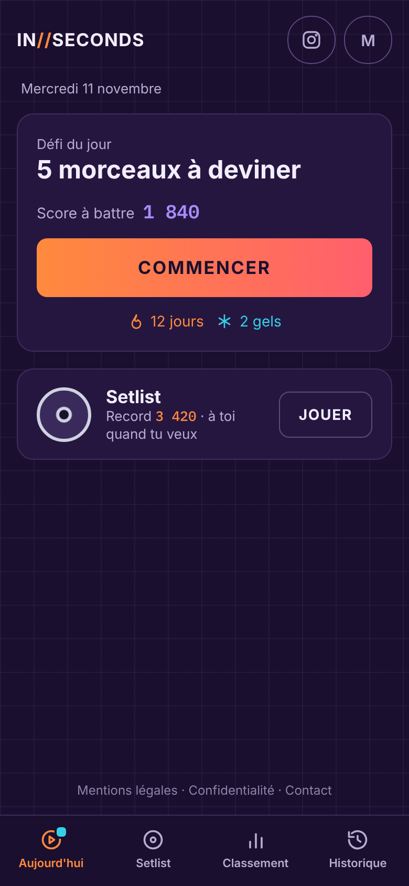 | 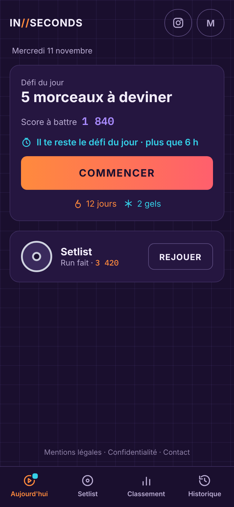 |
| Accueil, première visite | Accueil, retour dans la journée, défi pas fait |
| 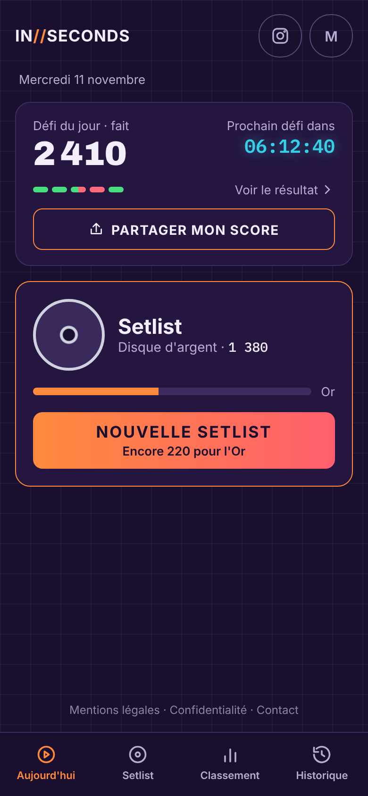 | 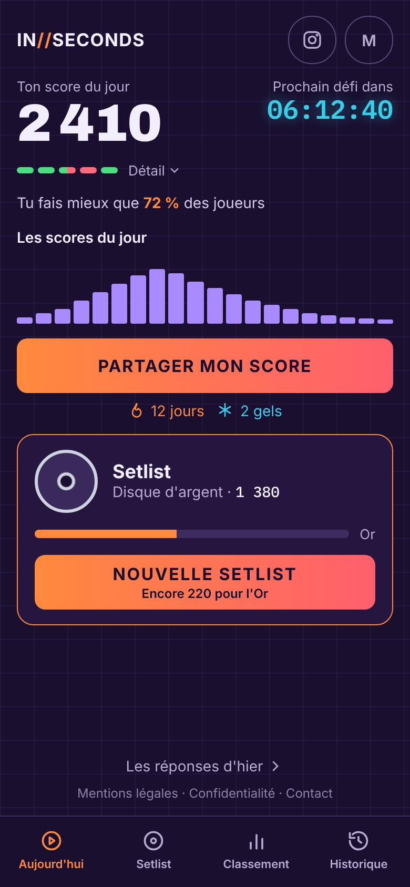 |
| Accueil, défi fait | Résultat du défi du jour, carte Survie |
| 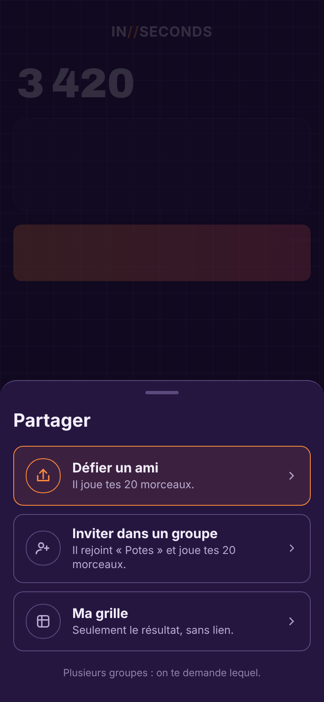 | 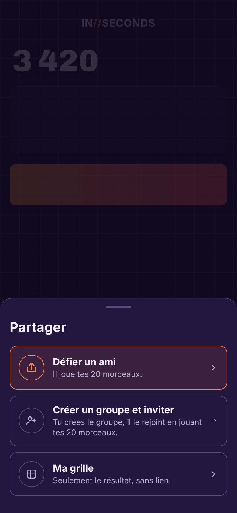 |
| Défier un ami | Défier un ami, sans groupe |
| 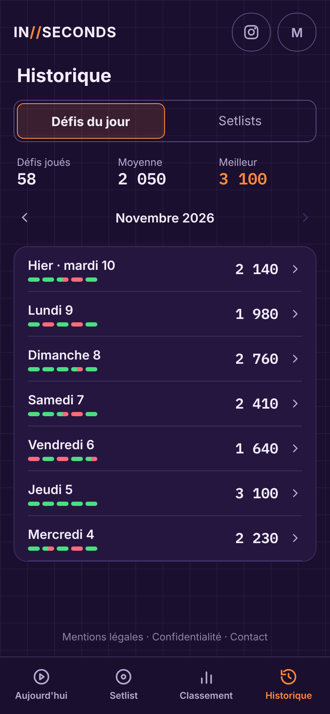 | 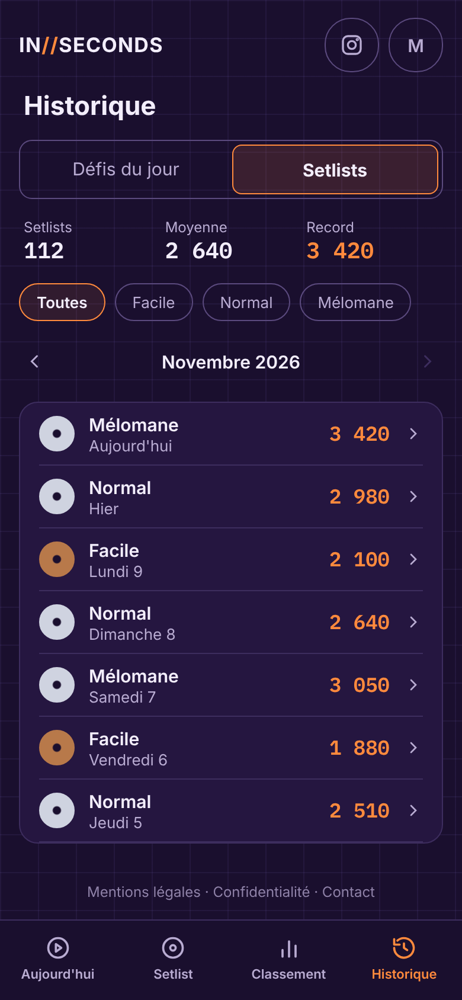 |
| Historique, défis du jour | Historique, Survie |
| 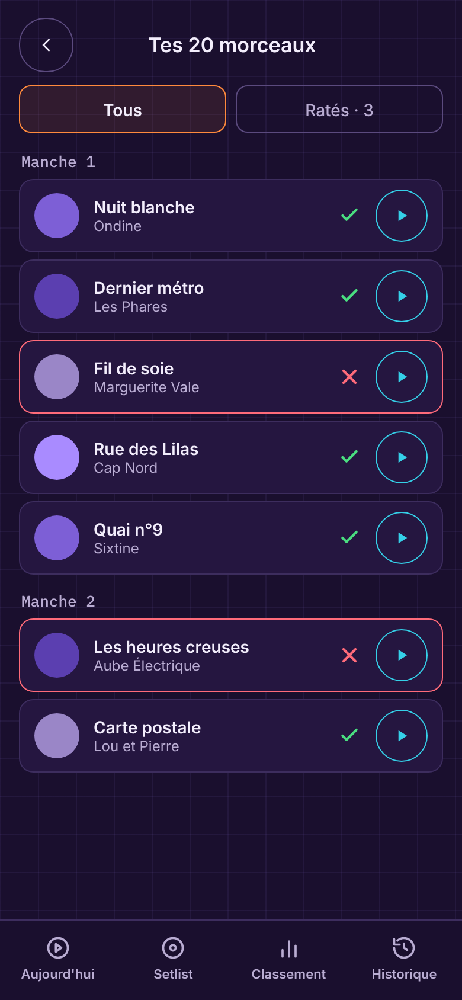 | 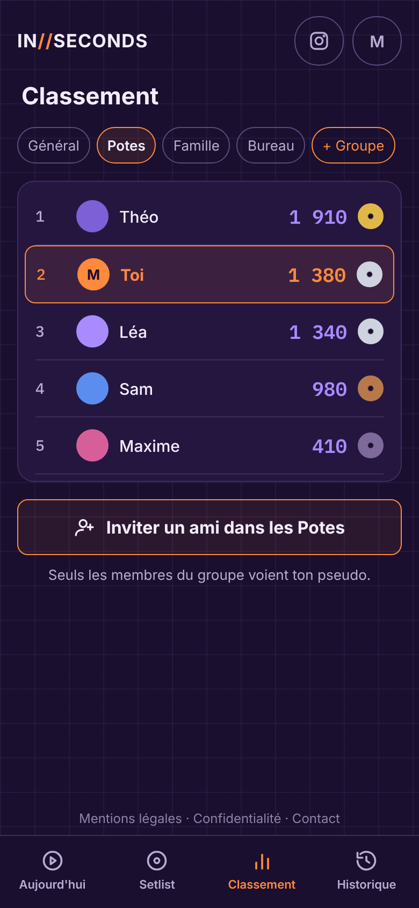 |
| Détail des morceaux (commun aux deux modes) | Classement d'un groupe |
| 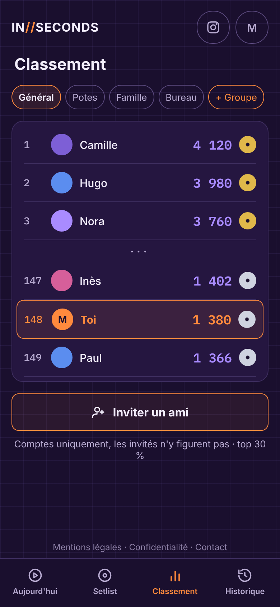 | 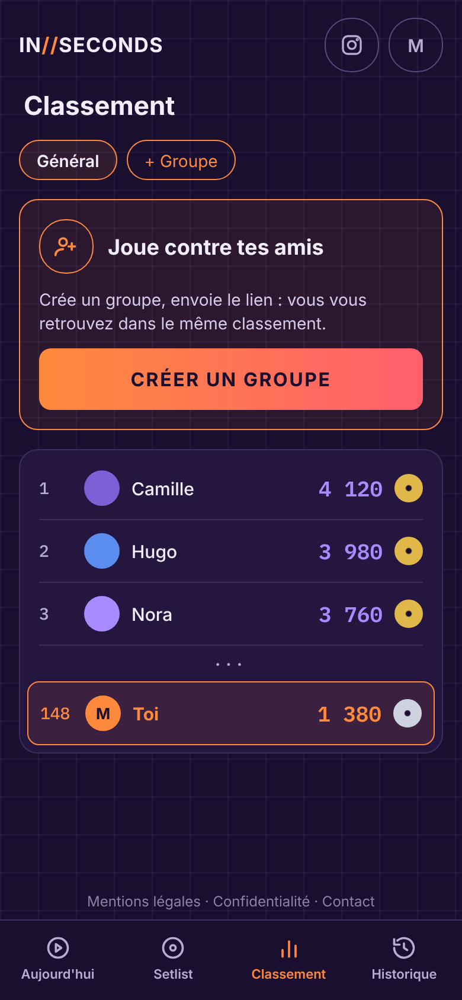 |
| Classement général | Classement sans groupe |
| 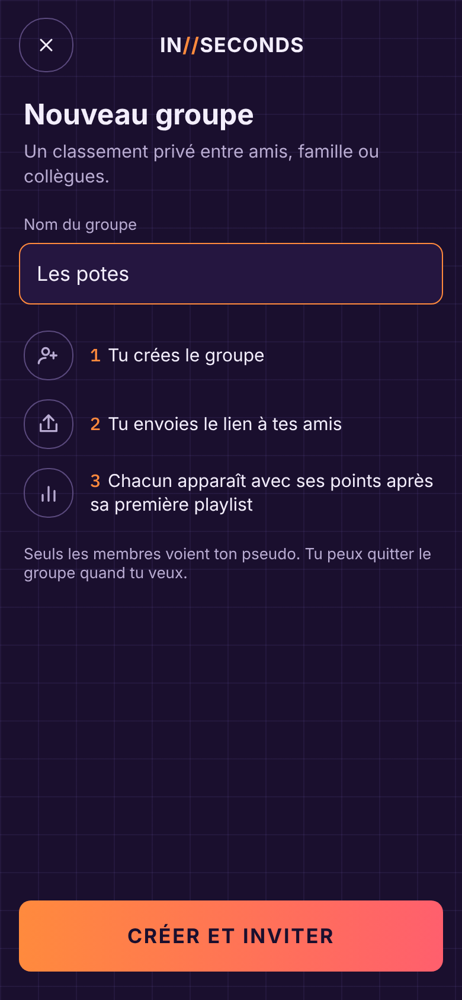 | 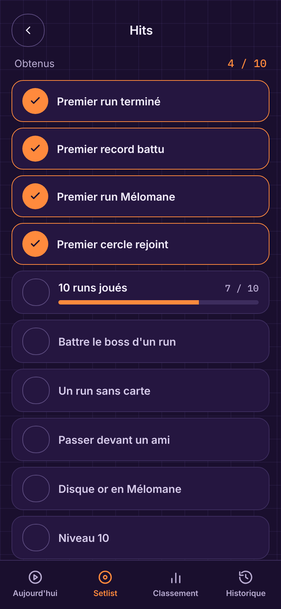 |
| Créer un groupe | Hits |
