# Run (Platines) : les écrans du proto 1

**Ces maquettes font référence** (Clément, 17/10/2026) : elles sont à intégrer telles quelles, avec le design système existant (tokens `:root` de `styles.scss`, `appButton`, composants du domaine `gameplay`, `ModalService`). Les images de `maquettes/` sont la copie figée de l'artifact Design « Platines » (lien dans #360). Les règles qu'elles montrent : [`regles.md`](regles.md).

Format : téléphone, 390 × 844. Les textes des maquettes sont ceux à reprendre dans les traductions FR (`runs.*`), à traduire en EN. Les chiffres sont des exemples.

## Ce qui est repris du Daily, sans le refaire

| Élément | Composant existant | Différence en run |
|---|---|---|
| Lecteur | `RoundPlayerComponent` (`gameplay/ui`) | écoute de 10 s d'un coup : pas de bouton « ▶ Xs » ni d'« écouter plus » |
| Saisie | champ avec autocomplétion de la manche (`app-track-round`) | placeholder « Artiste - Titre » avec un tiret simple (le Daily garde « - » tant que Clément n'a pas demandé d'aligner) |
| Valider, Passer, confirmations en ligne | boutons et confirmations de la manche du Daily | aucune |
| Lien « Abandonner » | celui de `daily-progress` (12 px, souligné, discret) | placé à gauche de l'en-tête |
| Forme de la pochette | `reveal-card` (forme organique) | taille 96 px dans la carte de réponse |
| Liste des morceaux | lignes de `track-results-list` (écran « déjà joué ») | sans le clic qui ouvre le graphique, sans la ligne de statistiques |
| Lien Deezer | « ▶ Écouter sur Deezer » du Daily | aucune |

## Écrans du Daily repris tels quels, sans maquette

Clément, 18/10 : un écran qui existe déjà au Daily ne se redessine pas, il se reprend tel quel. Seuls les textes changent (un run n'a ni série ni limite de jour). Les composants qui vivaient dans `daily/ui` sont descendus dans `gameplay/ui` pour que Runs puisse les utiliser (cf. [`conception.md`](conception.md) § 5.3) : la liste des morceaux, le badge Deezer, l'écran de reprise.

| Situation | Écran du Daily | Textes à adapter en run |
|---|---|---|
| Reprise d'une partie en cours | `resume-screen` (« Partie en pause », « X / Y pistes déjà écoutées », Reprendre / Abandonner, confirmation d'abandon sur place) | le compte porte sur les 20 morceaux ; avertissement d'abandon sans la série : « Cette partie sera perdue et ne comptera pas pour ton record. » ; pas de « Ne plus perdre mes parties » (l'accès demande déjà un compte, l'ami invité le garde) |
| « Abandonner » pendant une manche | `ModalService.confirm` de `daily.page` (« Abandonner la partie ? ») | corps : « Cette partie sera perdue et ne comptera pas pour ton record. » (Clément, 23/10) |
| Quitter la page pendant une partie | `leave-game.guard` + `ConfirmDialog` (« Partie en cours », « Quitter quand même » / « Continuer à jouer ») | corps : la partie se reprend plus tard, sans limite de jour |
| Extrait illisible (réseau, CDN) | phase `audio-error` de `round-player` (« Réessayer » / « Passer (0 pts) ») | aucun |
| Réponse non envoyée | encart `submit-error` de `track-round` | aucun |
| Erreur avec code | `status-screen`, écran `error` (« Une erreur est survenue » + code d'erreur) | corps : « Impossible de charger la playlist. » |
| Pool trop petit (`runs.no_challenge`) | `status-screen`, écran `no_challenge` | texte à écrire, par exemple « Pas assez de morceaux pour une playlist, reviens plus tard. » |
| Service indisponible | overlay `core/shell/service-down` | aucun, commun à toute l'app |

Sans écran du tout :
- **Accès refusé** (`runs.access_denied` sur `/runs`) : retour au Daily.
- **Lien d'une playlist déjà jouée** : directement la comparaison (§ 5), livré en P5 ; une playlist en cours mène à l'écran de reprise.

## 1. La manche

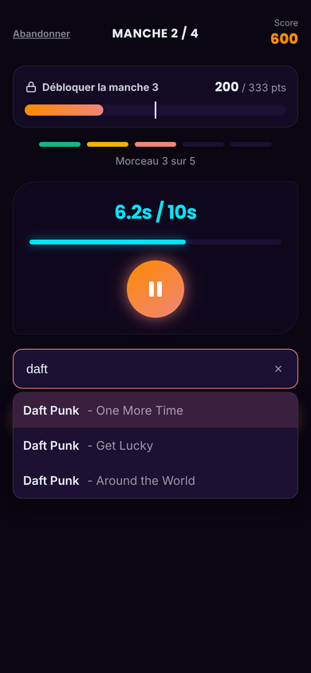

De haut en bas :
- **En-tête** sur trois colonnes : « Abandonner » à gauche, « MANCHE 2 / 4 » centré, « Score » et le score total du run à droite (accent orange).
- **Bloc objectif** : cadenas et « Débloquer la manche 3 », « 200 / 333 pts » (score de la manche / objectif), barre de jauge en dégradé avec un trait vertical à l'objectif. Sur la dernière manche, le libellé dit « Viser le disque d'or ».
- **5 pastilles** des morceaux de la manche et « Morceau 3 sur 5 » : vert = trouvé, ambre = à moitié (artiste ou titre), corail = morceau en cours, sombre = à venir. Un morceau raté prend la couleur `--danger` (pas dessiné dans les maquettes, déduit).
- **Lecteur du Daily** : « 6.2s / 10s », barre cyan, bouton lecture/pause.
- **Saisie du Daily** : champ « Artiste - Titre » avec propositions, puis VALIDER et PASSER (0 PTS).

Confirmations en ligne, à la place des boutons, comme au Daily :

| Passer | Valider un champ vide |
|---|---|
|  | 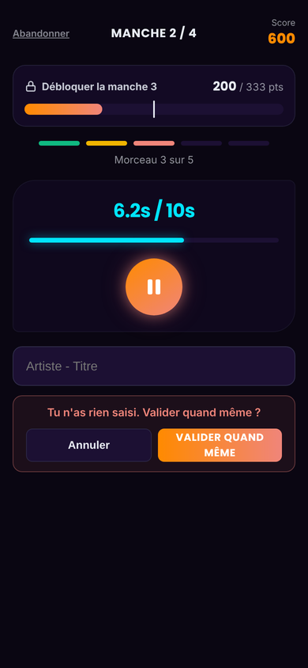 |

## 2. La réponse après chaque morceau (nouvelle étape)

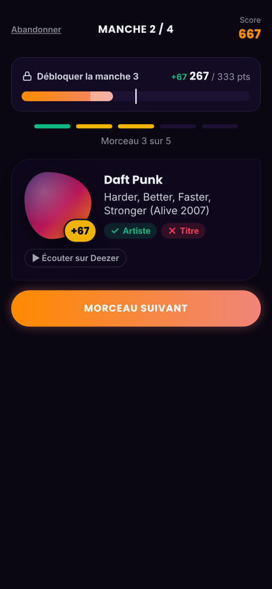

Après Valider ou Passer, **on reste dans l'écran de la manche** : le lecteur et la saisie laissent place à une carte de réponse, le reste de l'écran ne bouge pas.
- **Carte** aux coins du lecteur (28 / 8 px) : pochette à la forme de la révélation du Daily, **pastille jaune « +67 »** (points du morceau) posée sur le coin de la pochette ; à droite, l'artiste puis le titre, **deux lignes au plus chacun** (coupés au-delà, les noms longs sont fréquents) ; pastilles « ✓ Artiste » (vert) et « ✗ Titre » (rouge) ; dessous, « ▶ Écouter sur Deezer ».
- **Bloc objectif** : « +67 » en vert devant le nouveau score de la manche, et la part gagnée surlignée dans la barre.
- La pastille du morceau prend sa couleur, le score de l'en-tête se met à jour.
- **« MORCEAU SUIVANT »** juste sous la carte. Ce clic lance le son du morceau suivant (geste du joueur, obligatoire sur iPhone). Après le 5e morceau, il s'appelle « Fin de la manche » et mène au bilan.

## 2b. Le morceau sans extrait

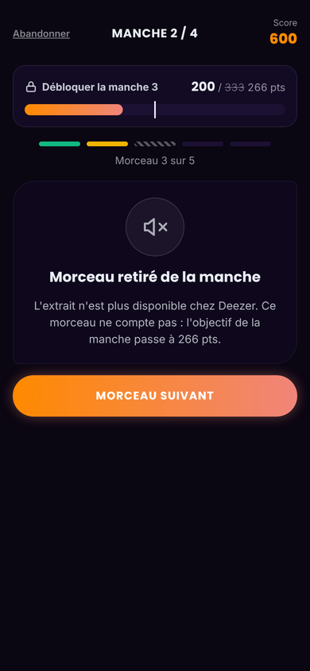

Quand Deezer n'a plus d'extrait pour le morceau en cours, le serveur le neutralise ([`regles.md`](regles.md#la-jauge)). On reste dans l'écran de la manche ; à la place du lecteur et de la saisie :
- une carte « **Morceau retiré de la manche** » : « Impossible de récupérer l'extrait. Le morceau a été retiré de la playlist et l'objectif abaissé à 266 pts. » Le texte reste générique sur la cause, et rien ne révèle le morceau ;
- dans le bloc objectif, l'ancien objectif barré à côté du nouveau (« 200 / ~~333~~ 266 pts »), le repère de la jauge recalculé ;
- la pastille du morceau hachurée (ne compte pas) ;
- « MORCEAU SUIVANT » dessous, comme après une réponse (« Fin de la manche » si c'était le dernier morceau, qui mène au bilan).

Le retrait peut arriver après une réponse (le serveur passe au morceau suivant et n'en trouve pas l'extrait : la carte de réponse, puis celle du retrait) ou pendant la redemande d'extrait d'un morceau en cours (lecture en échec, adresse expirée : la carte du retrait remplace le lecteur). **Le son ne repart jamais seul** : chaque carte attend le clic du joueur.

À ne pas confondre avec l'extrait illisible (réseau, lien expiré) : là, on garde « Réessayer / Passer (0 pts) » du Daily.

## 3. La fin de manche

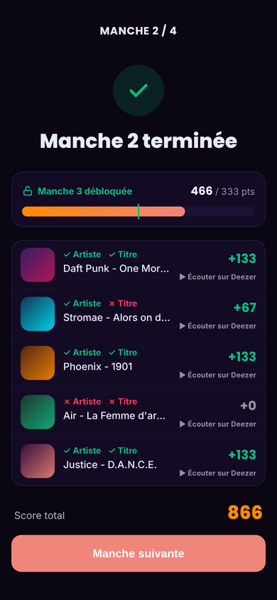

- « MANCHE 2 / 4 » en haut, puis l'icône ✓ et **« Manche 2 terminée »**.
- **Bloc objectif** : cadenas ouvert et « Manche 3 débloquée » en vert, « 466 / 333 pts », barre et trait à l'objectif (vert quand il est atteint). Dernière manche gagnée : « Disque d'or débloqué ». Manche ratée : ✕ à la place du ✓ et « Objectif manqué ».
- **Le bilan s'affiche après chaque manche**, ratée ou dernière comprise : son bouton devient alors « Voir le résultat » et mène à l'écran de fin.
- **Les 5 morceaux** dans les lignes de l'écran « déjà joué » du Daily : pochette, ✓/✗ Artiste et Titre, « Artiste - Titre » sur une ligne, points, « ▶ Écouter sur Deezer ». Un morceau retiré n'a pas de ligne (rien ne le décrit) : une phrase dessous dit « 1 morceau retiré de la manche ».
- **Score total** du run, puis **« Manche suivante »** juste dessous.

## 4. La fin du run

| Victoire | Défaite |
|---|---|
| 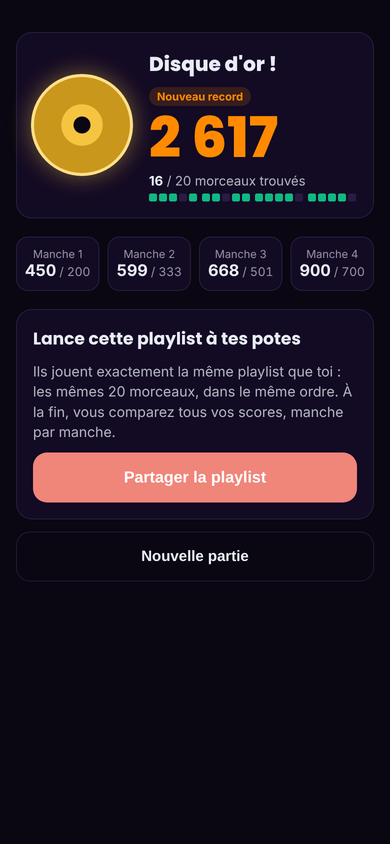 | 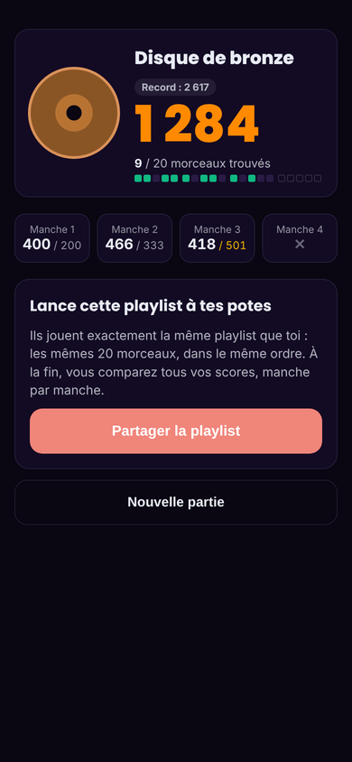 |

Même mise en page dans les deux cas :
- **Carte du disque**, horizontale : le disque dessiné à gauche (or, argent, bronze, cire, rayé) ; à droite, le nom du disque (« Disque d'or ! »), un badge « Nouveau record » ou « Record : 2 617 », le score final en grand, puis **« 16 / 20 morceaux trouvés »** et 20 petits carrés groupés par manche (vert = trouvé ; une manche non jouée en carrés vides).
- **4 cases** « Manche N » avec « score / objectif » ; l'objectif manqué en ambre ; **✕** pour une manche non jouée.
- **Bloc « Lance cette playlist à tes potes »** : « Ils jouent exactement la même playlist que toi : les mêmes 20 morceaux, dans le même ordre. À la fin, vous comparez tous vos scores, manche par manche. » et le bouton **« Partager la playlist »**, qui partage une phrase et l'adresse de la playlist (menu de partage du téléphone, sinon presse-papier, comme le partage du score au Daily) ; après une copie, le bouton dit « Lien copié ! » quelques secondes.
- **« Nouvelle partie »** dessous, en contour neutre : elle lance directement une playlist neuve, le son au même clic (un joueur sans accès voit à la place « Jouer au défi du jour »).
- Pas de « Voir les morceaux » : la liste a été vue à chaque fin de manche.

## 5. La comparaison d'une playlist

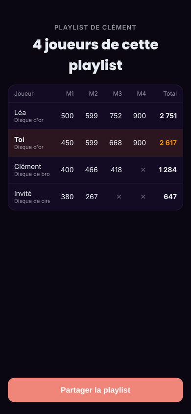

- Surtitre **« PLAYLIST DE CLÉMENT »** (pseudo de l'auteur, sans le code du lien), titre **« 4 joueurs de cette playlist »**.
- Tableau : Joueur (pseudo et disque dessous), M1 à M4, Total ; trié par total. **« Toi »** surligné en orange ; **✕** pour une manche non jouée ; « Invité » pour un joueur sans compte.
- **« Partager la playlist »** en bas.
- **Accès** : en ouvrant le lien (`/runs/<code>`) d'une playlist déjà jouée, et par « Voir les autres joueurs » (lien discret sous « Partager la playlist » de l'écran de fin). Une partie abandonnée y a accès aussi (la playlist ne se rejoue pas) ; elle n'est pas dans le tableau (seules les parties gagnées ou perdues y figurent). Égalité de total : plus de manches passées, puis la première terminée.

## 6. L'entrée sur l'accueil

| Accueil | Déjà joué |
|---|---|
| 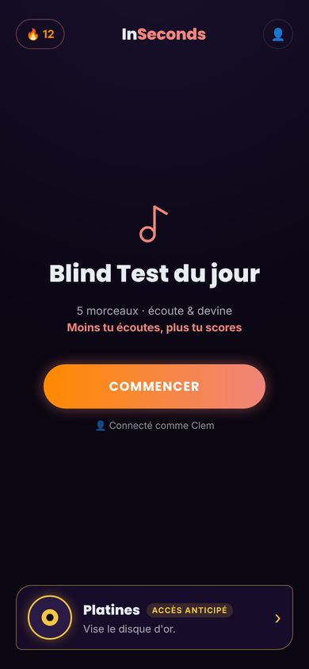 | 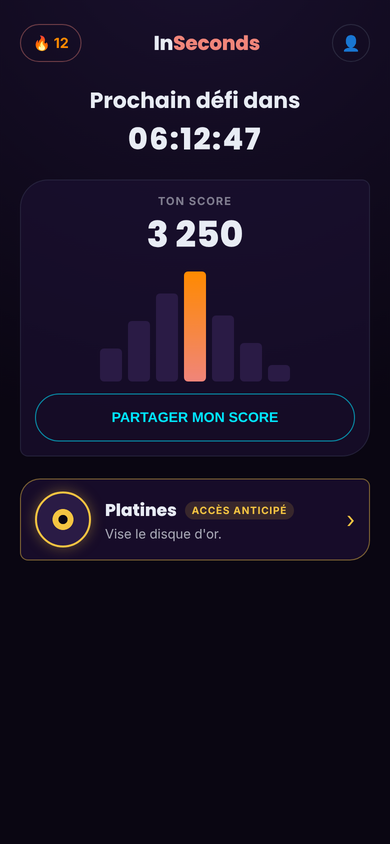 |

- **Seule la carte Platines est ajoutée** : rien d'autre ne change sur ces deux écrans (Clément, 17/10).
- Carte sous le contenu existant (en bas de l'accueil, sous le bloc du score sur « déjà joué ») : disque doré, « Platines », badge « ACCÈS ANTICIPÉ », « Vise le disque d'or. », chevron. Un clic ouvre `/runs`.
- Visible seulement pour un compte qui a l'accès, jamais pendant une manche.

## 7. Le lien reçu

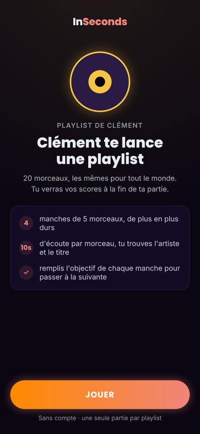

Ce que voit un ami qui ouvre `inseconds.cc/runs/<code>` sans avoir encore joué cette playlist, invité compris, avec ou sans accès à Platines :
- le logo seul en haut (ni série, ni compte : l'écran doit marcher pour un invité tout neuf) ;
- le disque d'or et le titre « Clément te lance une playlist » (pseudo de l'auteur, « Invité » à défaut), sans surtitre ;
- un bloc de quatre règles courtes : « 20 morceaux, les mêmes pour tous ses joueurs : comparez vos scores à la fin » (la comparaison n'est visible qu'après avoir joué, réponse à `runs.comparison_locked`), « 4 manches, de plus en plus dures », « 10s pour trouver l'artiste et le titre », « passe les 4 manches et deviens **disque d'or** » (petit disque doré en pastille) ;
- **« JOUER »** juste sous le bloc des règles, qui crée l'invité si besoin et lance la partie (le son démarre à ce clic). Ni surtitre ni nombre de joueurs sur cet écran.

Partie déjà commencée sur ce lien : l'écran de reprise du Daily. Partie finie : la comparaison (§ 5).

## Écarts entre les maquettes et l'app livrée

Les images de `maquettes/` sont la copie figée du 18/10/2026 ; l'app a évolué depuis. Ce qui diffère, pour ne pas intégrer une maquette périmée :
- **Pochettes rondes** (décision UI du 21/10), comme la révélation du Daily, et badge officiel Deezer pour « Écouter sur Deezer » (conditions de l'API, piège 47), au lieu du lien maison.
- **Bouton après le 5e morceau** : « Fin de la manche » (et non « Morceau suivant ») ; sur le bilan d'une manche qui termine le run (ratée ou dernière), « Voir le résultat » à la place de « Manche suivante ».
- **« MANCHE 2 / 4 »** : le texte traduit est « Manche 2 / 4 », mis en capitales par la mise en forme (un lecteur d'écran ne l'épelle pas).
- **Fin du run** : sans grandes cartes, dans le style du résultat du jour (le disque, le record, le score dans la police du score, les cases par manche, le bloc de partage sans cadre) ; bouton de partage commun avec le Daily. Un lien discret **« Voir les autres joueurs »** est ajouté sous « Partager la playlist » (la comparaison n'était sinon atteignable que par le lien).
- **Comparaison** : le tableau est en pleine largeur, sans carte, filets en haut et en bas comme la liste des morceaux du résultat du jour ; les totaux sont dans la police du score ; sa propre ligne s'appelle « Toi » (et non son pseudo).
- **Accès refusé** et **lien d'une playlist déjà jouée** : voir plus haut, sans écran ou directement la comparaison.

Les captures réelles qui remplaceraient les maquettes restent à faire (cf. [`../taches.md`](../taches.md)).
