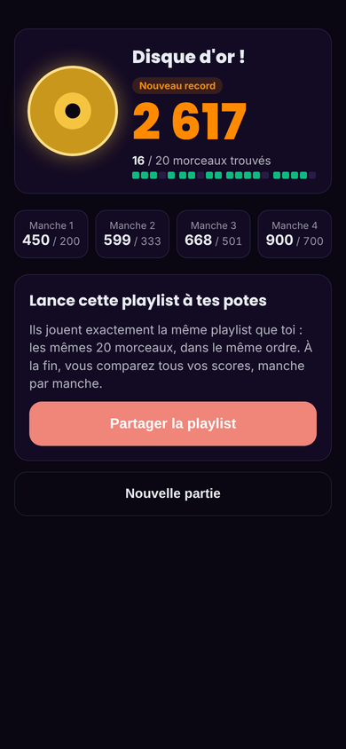
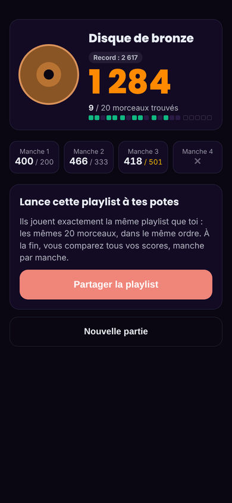
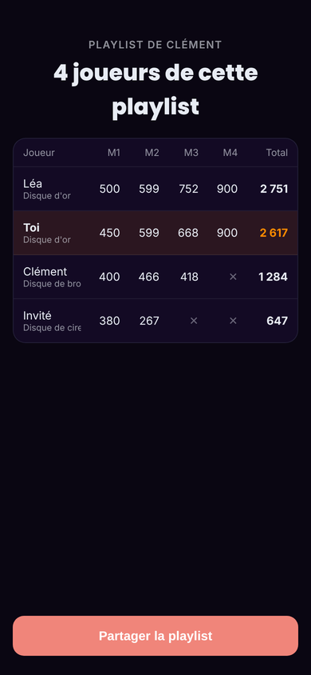
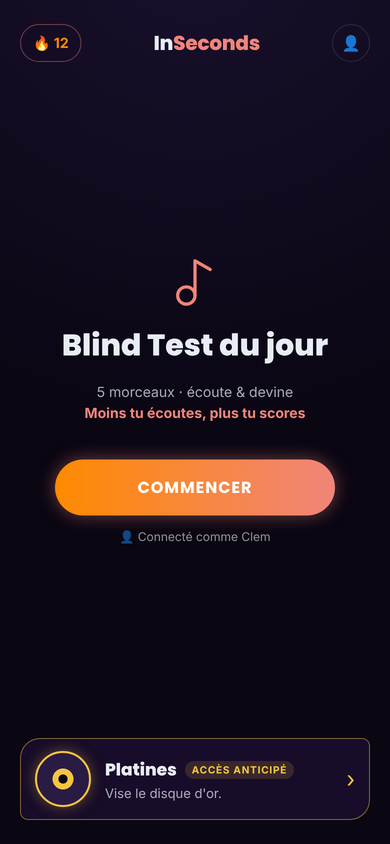
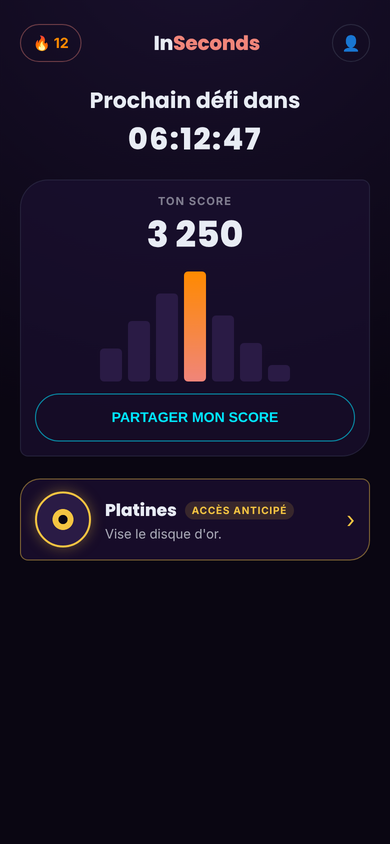
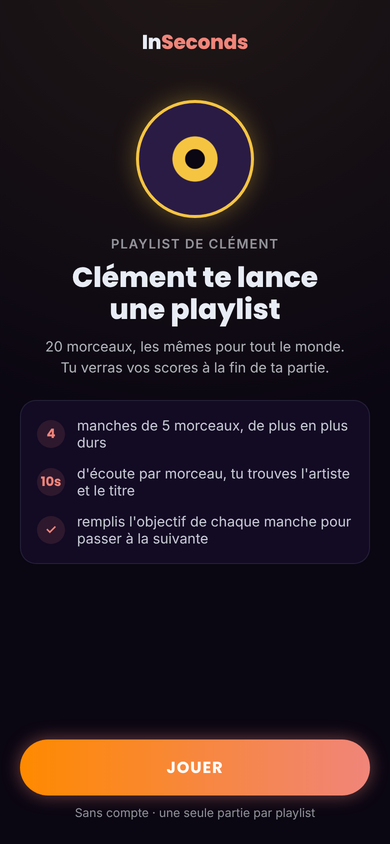

# Run (Platines) : les écrans du proto 1

**Ces maquettes font référence** (Clément, 17/10/2026) : elles sont à intégrer telles quelles, avec le design système existant (tokens `:root` de `styles.scss`, `appButton`, composants du domaine `gameplay`, `ModalService`). Les images de `maquettes/` sont la copie figée de l'artifact Design « Platines » (lien dans #360). Les règles qu'elles montrent : [`regles.md`](regles.md).

Format : téléphone, 390 × 844. Les textes des maquettes sont ceux à reprendre dans les traductions FR (`runs.*`), à traduire en EN. Les chiffres sont des exemples.

## Ce qui est repris du Daily, sans le refaire

| Élément | Composant existant | Différence en run |
|---|---|---|
| Lecteur | `RoundPlayerComponent` (`gameplay/ui`) | écoute de 10 s d'un coup : pas de bouton « ▶ Xs » ni d'« écouter plus » |
| Saisie | champ avec autocomplétion de la manche (`app-track-round`) | placeholder « Artiste - Titre » avec un tiret simple (le Daily garde « - » tant que Clément n'a pas demandé d'aligner) |
| Valider, Passer, confirmations en ligne | boutons et confirmations de la manche du Daily | aucune |
| Lien « Abandonner » | celui de `daily-progress` (12 px, souligné, discret) | placé à gauche de l'en-tête |
| Forme de la pochette | `reveal-card` (forme organique) | taille 96 px dans la carte de réponse |
| Liste des morceaux | lignes de `track-results-list` (écran « déjà joué ») | sans le clic qui ouvre le graphique, sans la ligne de statistiques |
| Lien Deezer | « ▶ Écouter sur Deezer » du Daily | aucune |

## Écrans du Daily repris tels quels, sans maquette

Clément, 18/10 : un écran qui existe déjà au Daily ne se redessine pas, il se reprend tel quel. Seuls les textes changent (un run n'a ni série ni limite de jour). Les composants qui vivaient dans `daily/ui` sont descendus dans `gameplay/ui` pour que Runs puisse les utiliser (cf. [`conception.md`](conception.md) § 5.3) : la liste des morceaux, le badge Deezer, l'écran de reprise.

| Situation | Écran du Daily | Textes à adapter en run |
|---|---|---|
| Reprise d'une partie en cours | `resume-screen` (« Partie en pause », « X / Y pistes déjà écoutées », Reprendre / Abandonner, confirmation d'abandon sur place) | le compte porte sur les 20 morceaux ; avertissement d'abandon sans la série : « Cette partie sera perdue et ne comptera pas pour ton record. » ; pas de « Ne plus perdre mes parties » (l'accès demande déjà un compte, l'ami invité le garde) |
| « Abandonner » pendant une manche | `ModalService.confirm` de `daily.page` (« Abandonner la partie ? ») | corps : « Cette partie sera perdue et ne comptera pas pour ton record. » (Clément, 23/10) |
| Quitter la page pendant une partie | `leave-game.guard` + `ConfirmDialog` (« Partie en cours », « Quitter quand même » / « Continuer à jouer ») | corps : la partie se reprend plus tard, sans limite de jour |
| Extrait illisible (réseau, CDN) | phase `audio-error` de `round-player` (« Réessayer » / « Passer (0 pts) ») | aucun |
| Réponse non envoyée | encart `submit-error` de `track-round` | aucun |
| Erreur avec code | `status-screen`, écran `error` (« Une erreur est survenue » + code d'erreur) | corps : « Impossible de charger la playlist. » |
| Pool trop petit (`runs.no_challenge`) | `status-screen`, écran `no_challenge` | texte à écrire, par exemple « Pas assez de morceaux pour une playlist, reviens plus tard. » |
| Service indisponible | overlay `core/shell/service-down` | aucun, commun à toute l'app |

Sans écran du tout :
- **Accès refusé** (`runs.access_denied` sur `/runs`) : retour au Daily.
- **Lien d'une playlist déjà jouée** : directement la comparaison (§ 5) ; une playlist en cours mène à l'écran de reprise.

## 1. La manche (écran en pile)

Clément, 03/11/2026 : l'écran de jeu a été refait (maquettes animées du fil « Platines » ; les images `maquettes/manche*.png`, `reponse.png`, `morceau-neutralise.png` et `fin-de-manche.png` sont périmées). Un seul écran pour toute la partie, de haut en bas :
- **En-tête** : ✕ (abandonner) à gauche, la barre du run en 4 segments (un par manche, rempli selon le score de la manche, vert une fois l'objectif atteint), puis « Manche 2 · encore 120 pts pour passer » (« objectif atteint » une fois passé). Ni score total ni mise en jeu dans l'en-tête.
- **Carte du morceau en cours**, compacte : bouton membrane de relecture à gauche de la forme d'onde (écoute fixe de 10 s, aucun palier), la saisie « Artiste - Titre », Valider et Passer (0 pts). Confirmations en ligne comme au Daily.
- **Chrono** : 45 s par morceau (`Runs:AnswerSeconds`), affiché « 0:45 » en gris en haut à droite de la carte. Il part au premier son et les réécoutes sont gratuites. Pendant les 5 dernières secondes, le chiffre passe en grand et en blanc, la carte prend un contour blanc translucide, et un tic sonne chaque seconde quand l'extrait ne joue pas. À 0, ce qui est tapé est envoyé. Le serveur fait foi : une réponse arrivée après le chrono (plus 5 s de marge) vaut 0 point, et le chrono continue de tourner quand le joueur s'absente (il le retrouve à la reprise).
- **La pile** sous la carte : « Total du run » en haut (et dessous, pour qui joue la playlist d'un autre, le fantôme de son auteur : son pseudo et son total au même morceau en violet, puis l'avance, le retard ou « À égalité », qui changent quand le total a fini de compter), puis tous les morceaux joués, du plus récent au plus ancien. Chaque manche passée est fermée par une **ligne de palier** : le disque gagné, le nom de la manche en blanc, ses filets à la couleur du disque, score / objectif. Les morceaux sous un palier ne gardent que la pochette, la forme d'onde et les points, grisés. Toucher une ligne ne relance rien.

## 2. La réponse

Après Valider, Passer ou la fin du chrono, la réponse s'affiche **dans la carte** : pochette ronde dans la membrane, forme d'onde, artiste et titre avec ✓/✗, points du morceau, badge Deezer. Les points s'envolent vers « Total du run », puis le morceau entre en tête de la pile. Le morceau suivant s'enchaîne seul après 2 s (barre de progression sur « Morceau suivant », qui reste cliquable) ; l'enchaînement automatique est coupé quand le système demande moins d'animations, le clic lance alors le son. Le dernier morceau d'une manche passée pose la ligne de palier ; une manche ratée ou la dernière manche mènent à l'écran de fin (« Voir le résultat »). **Il n'y a plus d'écran de bilan de manche** : la ligne de palier le remplace.

Animations par GSAP (`ui/motion/motion.ts`) : entrées courtes et amorties, sans rebond ni lueur, toutes coupées en mouvement réduit.

## 2b. Le morceau sans extrait

Quand Deezer n'a plus d'extrait pour le morceau en cours, le serveur le neutralise ([`regles.md`](regles.md#la-jauge)). La carte devient « **Morceau retiré de la manche** » : « Impossible de récupérer l'extrait. Le morceau a été retiré de la playlist et l'objectif abaissé à 266 pts. » Rien ne révèle le morceau, la pile le note « retiré ». « Morceau suivant » dessous, comme après une réponse.

À ne pas confondre avec l'extrait illisible (réseau, lien expiré) : là, on garde « Réessayer / Passer (0 pts) » du Daily.

## 4. La fin du run

| Victoire | Défaite |
|---|---|
|  |  |

Même mise en page dans les deux cas :
- **Carte du disque**, horizontale : le disque dessiné à gauche (or, argent, bronze, cire, rayé) ; à droite, le nom du disque (« Disque d'or ! »), un badge « Nouveau record » ou « Record : 2 617 », le score final en grand, puis **« 16 / 20 morceaux trouvés »** et 20 petits carrés groupés par manche (vert = trouvé ; une manche non jouée en carrés vides).
- **4 cases** « Manche N » avec « score / objectif » ; l'objectif manqué en ambre ; **✕** pour une manche non jouée.
- **Bloc « Lance cette playlist à tes potes »** : « Ils jouent exactement la même playlist que toi : les mêmes 20 morceaux, dans le même ordre. À la fin, vous comparez tous vos scores, manche par manche. » et le bouton **« Partager la playlist »**, qui partage une phrase et l'adresse de la playlist (menu de partage du téléphone, sinon presse-papier, comme le partage du score au Daily) ; après une copie, le bouton dit « Lien copié ! » quelques secondes.
- **« Nouvelle partie »** dessous, en contour neutre : elle lance directement une playlist neuve, le son au même clic (un joueur sans accès voit à la place « Jouer au défi du jour »).
- Pas de « Voir les morceaux » : la liste a été vue dans la pile pendant la partie.

## 5. La comparaison d'une playlist

- Surtitre **« PLAYLIST DE CLÉMENT »** (pseudo de l'auteur, sans le code du lien), titre **« 4 joueurs de cette playlist »**.
- Tableau : Joueur (pseudo et disque dessous), M1 à M4, Total ; trié par total. **« Toi »** surligné en orange ; **✕** pour une manche non jouée ; « Invité » pour un joueur sans compte.
- **« Partager la playlist »** en bas.
- **Accès** : en ouvrant le lien (`/runs/<code>`) d'une playlist déjà jouée, et par « Voir les autres joueurs » (lien discret sous « Partager mon score » de l'écran de fin). Une partie abandonnée y a accès aussi (la playlist ne se rejoue pas) ; elle n'est pas dans le tableau (seules les parties gagnées ou perdues y figurent). Égalité de total : plus de manches passées, puis la première terminée.

## 6. L'entrée sur l'accueil

| Accueil | Déjà joué |
|---|---|
|  |  |

- **Seule la carte Platines est ajoutée** : rien d'autre ne change sur ces deux écrans (Clément, 17/10).
- Carte sous le contenu existant (en bas de l'accueil, sous le bloc du score sur « déjà joué ») : disque doré, « Platines », badge « ACCÈS ANTICIPÉ », « Vise le disque d'or. », chevron. Un clic ouvre `/runs`.
- Visible seulement pour un compte qui a l'accès, jamais pendant une manche.

## 7. Le lien reçu

Ce que voit un ami qui ouvre `inseconds.cc/runs/<code>` sans avoir encore joué cette playlist, invité compris, avec ou sans accès à Platines :
- le logo seul en haut (ni série, ni compte : l'écran doit marcher pour un invité tout neuf) ;
- le disque d'or et le titre « Clément te lance une playlist » (pseudo de l'auteur, « Invité » à défaut), sans surtitre ;
- un bloc de quatre règles courtes : « 20 morceaux, les mêmes pour tous ses joueurs : comparez vos scores à la fin » (la comparaison n'est visible qu'après avoir joué, réponse à `runs.comparison_locked`), « 4 manches, de plus en plus dures », « 10 s d'écoute, 45 s pour trouver l'artiste et le titre » (« 10 s pour trouver l'artiste et le titre » pour une playlist sans chrono), « passe les 4 manches et deviens **disque d'or** » (petit disque doré en pastille) ;
- **« JOUER »** juste sous le bloc des règles, qui crée l'invité si besoin et lance la partie (le son démarre à ce clic). Ni surtitre ni nombre de joueurs sur cet écran.

Partie déjà commencée sur ce lien : l'écran de reprise du Daily. Partie finie : la comparaison (§ 5).

## Écarts entre les maquettes et l'app livrée

Les images de `maquettes/` sont la copie figée du 18/10/2026 ; l'app a évolué depuis. Ce qui diffère, pour ne pas intégrer une maquette périmée :
- **Pochettes rondes** (décision UI du 21/10), comme la révélation du Daily, et badge officiel Deezer pour « Écouter sur Deezer » (conditions de l'API, piège 47), au lieu du lien maison.
- **Écran de jeu** (§ 1 à 2b) : remplacé par l'écran en pile du 03/11 ; les maquettes de la manche, de la réponse, du morceau retiré et de la fin de manche ne font plus référence.
- **Fin du run** : sans grandes cartes, dans le style du résultat du jour (le disque, le record, le score dans la police du score, les cases par manche, le bloc de partage sans cadre) ; bouton de partage commun avec le Daily. Un lien discret **« Voir les autres joueurs »** est ajouté sous le partage (la comparaison n'était sinon atteignable que par le lien). Proto 2 (#503) : **« Rejouer »** devient le bouton principal, sous les manches, avec ce qui a manqué pour le disque suivant ; le bloc « Défie tes potes sur cette playlist » et **« Partager mon score »** (en contour neutre, la grille d'emojis et « Bats-moi ») viennent dessous ; l'accueil du mode montre l'étagère « Tes disques ».
- **Comparaison** : le tableau est en pleine largeur, sans carte, filets en haut et en bas comme la liste des morceaux du résultat du jour ; les totaux sont dans la police du score ; sa propre ligne s'appelle « Toi » (et non son pseudo).
- **Accès refusé** et **lien d'une playlist déjà jouée** : voir plus haut, sans écran ou directement la comparaison.

Les captures réelles qui remplaceraient les maquettes restent à faire (cf. [`../taches.md`](../taches.md)).
