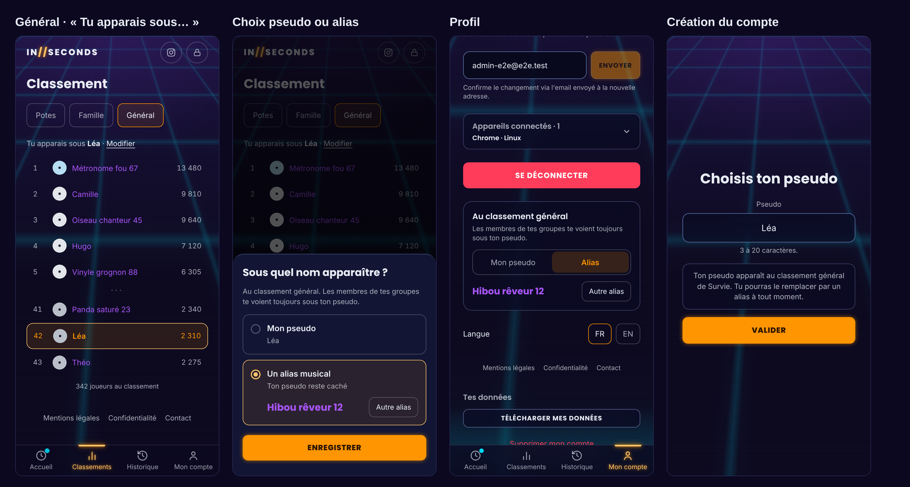
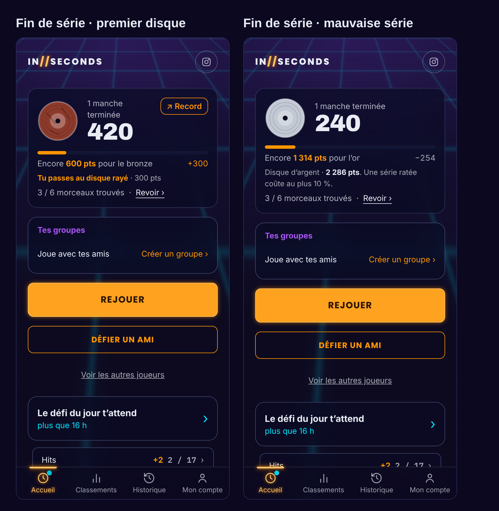

# Niveau et classement général de Survie : plan de dev

Chantier en cours : le niveau back (#607) est codé, le reste suit. Tickets [#607](https://github.com/Oasis35/InSeconds/issues/607) (niveau, back), [#608](https://github.com/Oasis35/InSeconds/issues/608) (niveau, front), [#609](https://github.com/Oasis35/InSeconds/issues/609) (classement général, back), [#610](https://github.com/Oasis35/InSeconds/issues/610) (classement général, front). Le code ne démarre qu'au « go » de Clément.

## Décisions

**Niveau**
- Pas de vrai Elo. Niveau = 80 % de l'ancien niveau + 20 % du score de la série ; une série baisse le niveau de 10 % au plus et fait monter d'un seul disque au maximum ; pas de niveau provisoire ; le fantôme n'influe pas.
- 7 disques, aucun sous 300 points : Rayé 300, Bronze 900, Argent 2 000, Or 3 600, Platine 6 000, Double platine 9 600, Diamant 13 000 (une partie parfaite après 1 à 7 manches ; réglage `Runs:Levels:Discs`, sans migration ; à réajuster sur des parties de testeurs).
- Inactivité : 14 jours de grâce, puis -5 % par semaine, plancher à la moitié, calculée à la lecture (aucune tâche nocturne).
- Les anciens niveaux sont remis à zéro par la migration.

**Classement général**
- Les comptes qui ont l'accès Survie (jamais un invité) : les 20 premiers, puis sa place et ses deux voisins ; cache d'une minute.
- Pseudo par défaut, alias musical au choix (animal ou objet musical + adjectif + 2 chiffres), **toujours unique** (ni déjà pris comme alias, ni égal à un pseudo de compte). Dans un groupe, les vrais pseudos.
- Pas de fenêtre : ligne fixe « Tu apparais sous Léa · Modifier » sur l'onglet Général et dans le profil.
- RGPD (gardien passé) : base légale intérêt légitime ; une ligne d'information à la création du compte, `/privacy` et `docs/conformite/rgpd.md` à jour, alias comme droit d'opposition, effacement et export de la nouvelle table. Reporté à l'ouverture à tous : mode « Masqué », masquage après 12 mois d'inactivité, bandeau d'information.

## Plan de dev

Quatre PR en brouillon vers `env/staging`, une branche chacune. Avant de sortir une PR du brouillon : `relecteur-pr`, gardiens concernés, tests, doc, Sonar.

| Vague | PR | Ticket | Contenu | Gardiens |
|---|---|---|---|---|
| 1 | A, niveau back | #607 | formule, plafond d'un disque, baisse max, 7 disques en réglages, inactivité à la lecture, migration de remise à zéro, compteurs Grafana, code Wolverine et OpenAPI | `gardien-code` |
| 1 | C, général back | #609 | nouvelle table (mode, alias unique), génération d'alias avec unicité, requêtes, cache, effacement et export, anonymisation du staging | `gardien-code`, `gardien-rgpd` |
| 2 | B, niveau front | #608 | 7 disques, carte Survie, fin de série, état sans disque, alerte d'inactivité, FR/EN, pluriel « 1 manche terminée » | `gardien-da` |
| 2 | D, général front | #610 | ligne « Tu apparais sous… », feuille pseudo ou alias, profil, ligne d'information à la création du compte, `/privacy`, `rgpd.md` | `gardien-da`, `gardien-rgpd` |

Les PR A et C avancent en parallèle ; B dépend de A et D de C. Ensuite : recette sur le staging, réglage des seuils sur des parties de testeurs, puis la promotion vers `main` sur le go de Clément. Plus tard : onglet « Cette semaine » des groupes, animation et Hit de passage de disque, nouveau visuel du disque rayé.

## Maquettes

Captures du jeu (staging) avec le texte des nouvelles règles injecté, pochettes remplacées par un aplat. Le disque rayé y est provisoire.

**Accueil** : niveau Argent, avant le premier disque, alerte d'inactivité.

**Classement général** : ligne « Tu apparais sous… », choix pseudo ou alias, profil, création du compte.

**Fin de série** : passage au premier disque, mauvaise série.

