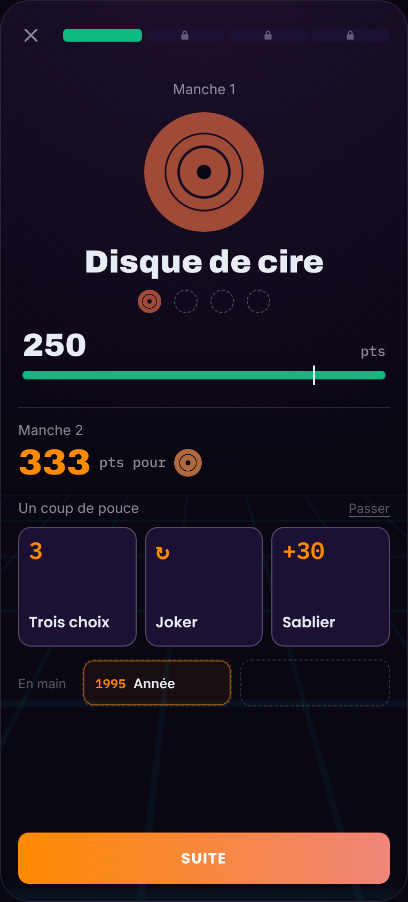
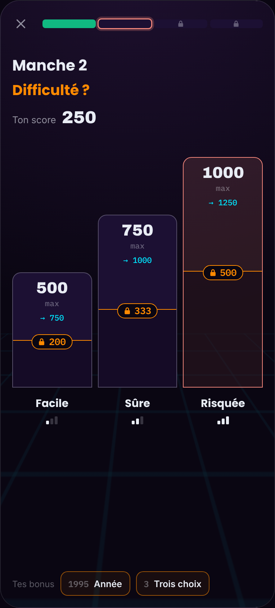
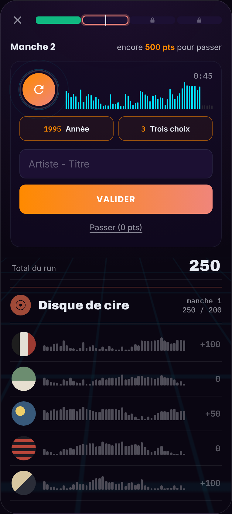

# Run (Platines) : proto 2, palier, difficulté et coups de pouce

Règles et écrans du proto 2, décidés avec Clément le 05/11/2026. **Rien de ce document n'est livré** : le proto 1 ([`regles.md`](regles.md)) reste la référence de ce qui tourne. Les chiffres marqués « provisoire » se règlent après les parties de test. Maquette interactive : artifact « Platines, palier et pari » sur claude.ai (privé) ; les captures de [`maquettes/`](maquettes/) (`proto2-*.png`) en sont tirées le 05/11/2026. Plan et tickets : [`plan.md`](plan.md).

## Ce que le proto 2 change

Le proto 1 enchaîne 4 manches sans choix. Le proto 2 ajoute, entre deux manches, un **moment de jeu** : le joueur voit ce qu'il a gagné, choisit un coup de pouce, puis **mise sur la difficulté** de la manche suivante. Le but est que le run soit rejouable, partageable et qu'il donne envie d'« encore une manche ».

Trois idées, rien d'autre :

1. [#498](https://github.com/Oasis35/InSeconds/issues/498) : un **écran de palier** après chaque manche passée ;
2. [#499](https://github.com/Oasis35/InSeconds/issues/499) : un **choix de difficulté** (Facile, Sûre, Risquée) qui fixe l'objectif et le plafond de points de la manche ;
3. [#500](https://github.com/Oasis35/InSeconds/issues/500) : des **coups de pouce** (cartes), 2 en main, à jouer sur un morceau.

Ce que le proto 2 ne fait pas : atouts passifs, contraintes, pactes, rareté, déblocages, run éclair, thèmes (cf. [`plan.md`](plan.md) § Bonus).

## Le déroulé

1. Dernier morceau de la manche : la carte rejoint la pile, la ligne de palier se pose (comme aujourd'hui).
2. **Écran de palier** (si la manche est passée) : le disque gagné, le score, l'objectif de la manche suivante, trois cartes à prendre, la main du joueur, « Suite ».
3. **Écran « Difficulté ? »** : trois colonnes, les bonus de la main en bas. Toucher une colonne lance le premier morceau de la manche, au même toucher (le son ne démarre que sur un geste, iPhone).
4. [#501](https://github.com/Oasis35/InSeconds/issues/501) : La manche se joue avec les cartes de la main au-dessus du champ de saisie.
5. [#502](https://github.com/Oasis35/InSeconds/issues/502) : Jauge non remplie à la fin de la manche : **fin du run**, comme au proto 1. Pas d'écran de palier, on va à la fin.

La première manche n'a ni palier ni choix de difficulté : le run démarre comme aujourd'hui, avec une carte offerte en main.

## L'écran de palier

Du haut vers le bas, sans phrase d'explication :

- la barre du run (4 segments), le numéro de la manche passée ;
- le **disque gagné**, grand, son nom, et l'étagère des disques de l'échelle (le suivant en pointillé) ;
- le **score** du run avec sa jauge et le repère de l'objectif franchi ;
- « Manche 2 » et l'objectif suivant en gros (« 333 pts pour » + le disque visé) ;
- **trois cartes** à toucher (icône et nom seulement) et « Passer » en lien : le joueur en prend une ou refuse ;
- la **main** (2 emplacements) ;
- « Suite ».

Le disque se pose, le score monte jusqu'au repère, les cartes arrivent une à une : animations GSAP par la façade `ui/motion`, rien entre le toucher et `play()` (pièges 44 et 46), `prefers-reduced-motion` respecté.

## La difficulté de la manche

Trois colonnes à plat sur une base commune, hauteur proportionnelle au **plafond de points** de la manche, avec en pointillé l'**objectif** : un cadenas et son chiffre posés sur la frontière, la zone dessous assombrie. Titre « Difficulté ? », « Ton score » en haut, le total atteignable (« → 1250 ») sous chaque plafond, les bonus en main en bas. Aucune colonne n'est présélectionnée.

| Difficulté | Objectif (provisoire) | Plafond de la manche (provisoire) |
|---|---|---|
| Facile | 200 | 500 |
| Sûre | 333 | 750 |
| Risquée | 500 | 1 000 |

Règles :

- **Objectif non atteint à la fin de la manche : fin du run**, quelle que soit la difficulté. C'est la mise.
- Les points de chaque morceau sont **mis à l'échelle de la difficulté choisie** : le plafond de la colonne est le maximum de la manche avec ce facteur. Dépasser l'objectif est utile : seul le plafond limite le score, et une difficulté plus haute rapporte plus pour la même qualité de réponse.
- **Jamais de points acquis retirés** : rien ne se multiplie sur le total du run.
- Les plafonds ne se chevauchent presque pas : pour dépasser le plafond de Facile il faut s'engager sur une difficulté plus haute.
- L'objectif de « Sûre » est celui du proto 1 pour la manche (seuils de départ ci-dessous). Facile et Risquée sont des fractions et des multiples de ce seuil, à régler.
- **Dernière manche** : « Risquée » est la **manche boss** (écoute de 5 s). Elle n'est jamais imposée. À confirmer après les parties de test, pour ne pas braquer les débutants.
- **Seuils de départ** (`Runs:ThresholdPercents`) : 45, 55, 65, 75 % du maximum de la manche (au lieu de 40, 50, 60, 70), à ajuster après les parties de test. Les anciennes playlists gardent leurs règles figées.

Questions à trancher avec les parties de test : barème exact des trois colonnes, facteurs de points, objectif de Facile (reste-t-il proche de Sûre ?), boss à 5 s.

## Les coups de pouce

Des cartes à **usage unique**, jouées sur le morceau en cours. **2 emplacements en main**. Le joueur en reçoit **une au départ du run** et peut en prendre **une parmi 3** à chaque palier (ou aucune). Main pleine : il touche la carte à lâcher, ou refuse l'offre.

| Carte | Effet (provisoire) |
|---|---|
| Trois choix | l'autocomplétion est remplacée par trois réponses, une seule est juste |
| Joker | change de morceau |
| Année | affiche l'année du morceau |
| Initiales | affiche les initiales de l'artiste et du titre |
| Rallonge | 20 s d'écoute au lieu de 10 |
| Filet | un morceau raté compte comme à moitié trouvé |
| Seuil abaissé | l'objectif de la manche baisse de 20 % (gardée pour la manche, pas pour un morceau) |
| Sablier | 30 s de plus au chrono de 45 s, **ou** chrono suspendu : à trancher, reco +30 s |

- Les **offres sont les mêmes pour tous les joueurs de la playlist** et figées avec elle : la comparaison reste juste.
- **Rien d'une carte n'identifie un morceau avant la réponse** (piège 31) : « Année » et « Initiales » sont servies par le serveur à l'activation, jamais envoyées d'avance. « Trois choix » : les deux fausses réponses viennent du serveur, qui ne dit pas laquelle est juste.
- Sur l'écran de manche, les cartes sont **au-dessus du champ de saisie** ; « Passer (0 pts) » reste un simple lien souligné sous « Valider ».
- Une carte jouée monte dans la carte du morceau (animation), le serveur en tient le compte (une carte ne se joue qu'une fois).

## Fin du run, partage et viralité

- **Rejouer** devient l'action principale de l'écran de fin, avec ce qui a manqué (« 12 points avant le prochain disque »).
- **Partage en grille** : une ligne d'emojis par manche (trouvé, à moitié, raté, comme le partage du Daily) avec la difficulté choisie, le disque, le score et le lien `?utm_source=share`, plus une invitation « Bats-moi » vers la même playlist.
- **Fantôme** : seulement celui d'un **ami sur la même playlist** (par son lien) : l'écart avec lui à chaque morceau. Il n'y a pas de fantôme de son propre record (Clément, 05/11).
- **Combo visuel** : série de bonnes réponses affichée, sans aucun point.
- **Sons d'interface** : sons à nous, libres de droits, jamais pendant un extrait, avec un bouton pour les couper.
- Étagère des disques gagnés sur l'accueil du mode.

## Ce que cela change côté code

Les noms exacts viendront de la conception ([`conception.md`](conception.md) § 7 prévoit déjà que les bonus décorent `IRunScoringPolicy` et modifient `RunRules`).

- **Règles figées dans la playlist** : les trois difficultés de chaque manche (objectif, plafond, facteur de points), les offres de cartes de chaque palier et la carte de départ sont tirées **à la création** et enregistrées avec la playlist (`rules` en `jsonb` et colonnes de tirage). Les playlists existantes n'ont pas ces champs : elles se jouent comme au proto 1, sans palier ni choix.
- **Tirage** : pour la même manche, les trois difficultés peuvent tirer des morceaux de tranches de rang Deezer voisines ; chaque manche a ses morceaux principaux et une réserve pour « Joker ». Tout est enregistré à la création (même playlist pour tous).
- **La partie** retient, par manche, la difficulté choisie, les cartes prises, lâchées et jouées, et les morceaux remplacés par un Joker. Aucune nouvelle donnée de joueur hors de la partie (l'effacement du joueur la couvre déjà, piège 48).
- **Calcul des points** : côté serveur uniquement ; la difficulté et chaque carte sont des décorateurs de la politique de score ou des modificateurs des règles de la manche. Le client ne propose jamais de score.
- **Routes** : choix de la difficulté (qui démarre le morceau), prise d'une carte, jeu d'une carte, lâcher une carte ; erreurs en ProblemDetails avec codes stables `runs.*`.
- **Front** (domaine `runs/`) : écran de palier, écran de difficulté, main, cartes au-dessus du champ, grille de partage ; textes FR/EN ; animations par `ui/motion`.
- **Mesure** : compteurs par difficulté choisie, par carte prise et jouée, et part des runs perdus à l'objectif (`RunsMetrics`, tableau Grafana « Activité »).
- **Tests** : unitaires des politiques de score et des cartes, intégration des routes, E2E (palier, difficulté, carte jouée, run perdu), tests de règles figées d'une playlist déjà créée.

## Découpage en tickets

Epic [#368](https://github.com/Oasis35/InSeconds/issues/368), ticket parent du proto 2 [#497](https://github.com/Oasis35/InSeconds/issues/497) ; chaque sous-ticket est une ou deux PR vers `env/staging`.

1. Règles figées d'un run : difficultés par manche, seuils de départ, tirage (back).
2. Cartes : modèle, main, offres, routes, décorateurs de points (back).
3. Écran de palier et main (front).
4. Écran « Difficulté ? » et départ de la manche au toucher (front).
5. Cartes jouées sur l'écran de manche (front).
6. [#503](https://github.com/Oasis35/InSeconds/issues/503) : Fin du run : « Rejouer » en principal, partage en grille et « Bats-moi » (back et front).
7. [#504](https://github.com/Oasis35/InSeconds/issues/504) : Fantôme d'un ami, combo visuel, sons d'interface (front, une PR chacun).
8. [#505](https://github.com/Oasis35/InSeconds/issues/505) : Métriques, tableau Grafana, E2E, captures réelles et documentation à jour.
