# Proto 4 : la V4, une nouvelle navigation, des niveaux et des groupes

**Planifié, rien n'est codé.** Le proto 4 ([#555](https://github.com/Oasis35/InSeconds/issues/555)) donne envie de rejouer et de partager sans obliger ceux qui se moquent des classements. Il apporte une barre du bas, un accueil qui met le défi du jour et le mode côte à côte, un niveau qui progresse, des groupes entre amis et un classement. Il se livre en **8 PR** vers `env/staging`, chacune testée au staging avant la suivante. Les chiffres (niveau, limites) sont des réglages, à ajuster aux parties de test.

Les 16 écrans de référence sont dans [`maquettes/proto4/`](maquettes/proto4/), numérotés dans l'ordre de lecture. Ils viennent de la maquette interactive du 11/11/2026 (artifact Design privé) ; les pochettes y sont remplacées par des aplats de couleur (règle du piège 47).

## Ce qui est décidé

- **Nom du mode : Setlist** (ex-Platines), adresse **`/setlist`**, comme `/daily` pour le défi du jour. Le code garde `Runs` (module, schéma, routes d'API, réglages) ; seuls les textes et les routes du front changent. Les liens d'ami déjà partagés (`/runs/<code>`) continuent de marcher par redirection en gardant la query string.
- **Un seul flag** : toute la V4 (barre du bas comprise, nouvel accueil, historique, classement, groupes) est derrière l'accès Setlist existant (`runs.access`), sans flag à part. Sans l'accès, l'interface publique actuelle reste telle quelle, sans trous ; les deux coques vivent côte à côte, et les anciens écrans seront retirés quand tout le monde aura basculé.
- **Niveau** dans une table `runs.player_levels` (effacement et export compris, piège 48).
- **Groupes** : 15 membres au maximum, 5 groupes par joueur, nom de 24 caractères contrôlé comme les pseudos, le tout en réglages relus à chaud. Modération des noms de groupe et des pseudos dans l'admin.
- **Classement général par niveau**, pas par meilleur score (un score trouvé avec Shazam y pèse peu) : le top 20 puis ta place avec tes voisins, pour les comptes qui ont choisi d'apparaître ; les autres voient une position anonyme (« top 30 % »).
- **Un seul bouton de partage** : « Défier un ami » envoie la grille et le lien de la même playlist ; « Ma grille » n'envoie que les emojis, sans lien.
- **« Groupe »** et **« Hits »** (ex-exploits) sont les noms retenus.
- **Renversement de « pas de leaderboard permanent »** ([`../architecture/decisions.md`](../architecture/decisions.md)) : il commence avec les groupes (PR 5 et 6), un classement durable entre pseudos, et se poursuit avec le classement général (PR 8). `decisions.md` et `/privacy` se mettent à jour dès la PR 5.

## Découpage en 8 PR

| # | PR | Ticket | Taille | Dépend de |
|---|---|---|---|---|
| 1 | Flag V4 et renommage Setlist | [#556](https://github.com/Oasis35/InSeconds/issues/556) | S | rien |
| 2 | Nouvelle coque : navigation et accueil | [#557](https://github.com/Oasis35/InSeconds/issues/557) | L | 1 |
| 3 | Historique des défis et des setlists | [#558](https://github.com/Oasis35/InSeconds/issues/558) | M | 2 |
| 4 | Niveau, disques et fin de run | [#559](https://github.com/Oasis35/InSeconds/issues/559) | L | 1, 2 |
| 5 | Groupes, côté back (module `Social`) | [#560](https://github.com/Oasis35/InSeconds/issues/560) | L | 1 |
| 6 | Classement, création de groupe et partage | [#561](https://github.com/Oasis35/InSeconds/issues/561) | L | 2, 4, 5 |
| 7 | Modération des groupes et des pseudos dans l'admin | [#562](https://github.com/Oasis35/InSeconds/issues/562) | M | 5 |
| 8 | Classement général et Hits | [#563](https://github.com/Oasis35/InSeconds/issues/563) | M | 4, 5, 6 |

Ordre : la 1 d'abord (petite, elle fixe le vocabulaire et le flag), puis 2 et 5 en parallèle (elles ne touchent pas aux mêmes fichiers), ensuite 3, 4 et 7, puis la 6, la 8 en dernier. Les PR 1 à 4 n'ajoutent aucune notion sociale et peuvent partir en prod avant le reste. Chaque PR porte ses tests (unitaires, intégration, E2E), la mise à jour de la doc et des tableaux Grafana, et passe par `relecteur-pr` avant de sortir du brouillon.

## PR 1 : flag et renommage

Un store front dit si le joueur voit la V4 (c'est `hasAccess` de `GET /api/runs/me`, déjà lu pour l'accès ; un invité sans accès voit l'ancienne coque). Les textes « Platines » deviennent « Setlist » (FR et EN, titres, partage, doc). Routes `/setlist` et `/setlist/<code>` ; `/runs` et `/runs/<code>` sont redirigées. Le sitemap, la CSP et `Auth:TrustedOrigins` ne changent pas. Tests : E2E des redirections (dont un lien d'ami), spec du store.

## PR 2 : nouvelle coque, navigation et accueil

Pour les joueurs avec le flag uniquement.

- **Barre du bas** à 4 onglets (Aujourd'hui, Setlist, Classement, Historique), masquée pendant une manche et sur les écrans de jeu. En-tête : logo, Instagram, compte. Une ligne « Mentions légales · Confidentialité · Contact » au-dessus de la barre ; le choix FR/EN passe dans la page du compte. Les mentions légales et la confidentialité restent joignables depuis chaque écran, dans les deux coques.
- **Accueil à deux états** : défi à faire (le Daily en grand, la Setlist discrète) ; défi fait (un résumé du Daily avec « Partager mon score », la Setlist en grand). Écrans 1 à 3.
- **Défi pas fait** : l'icône « Aujourd'hui » s'agite avec une pastille cyan, tant que le défi n'est pas joué (dès la première visite, sans condition), et un texte cyan « Il te reste le défi du jour · plus que 6 h » respire au-dessus de « Commencer » au retour dans la journée. Mouvement réduit si `prefers-reduced-motion`. Rien n'est forcé : à la première visite du jour, on accueille.
- **Résultat du Daily** : une carte Setlist (record en attendant le disque) sous la série (écran 8).
- Back : petit résumé Setlist du joueur (record, dernier run) sous le flag.

Sans le flag, l'accueil et le pied de page restent inchangés (E2E). Passage de `gardien-da`.

## PR 3 : historique

Deux onglets, Défis du jour et Setlists (écrans 9 et 10) : résumé en haut (nombre, moyenne, meilleur ou record), un mois à la fois avec les flèches, filtre par difficulté pour les setlists, un toucher ouvre le détail des morceaux (écran 11, composant commun aux deux modes : filtre « Tous / Ratés », ▶ par morceau ; le détail du Daily existe déjà, celui des setlists vient de la fin de run et de « Revoir »). Le lien des réponses des jours passés vit ici (il quitte l'accueil). Back : `GET /api/daily/history?month=` (module `Daily`) et `GET /api/runs/history` (module `Runs`), en lecture seule par des ports `I...Queries`, sans nouvelle table. Passage de `gardien-rgpd`.

## PR 4 : niveau, disques et fin de run

- **Points de niveau** : moyenne glissante des performances de run (monte et descend, provisoire avant 3 runs, pas de décroissance d'inactivité pour l'instant). **Disques** : Rayé, Cire, Bronze, Argent, Or, Platine, Double platine, Diamant. Formule et seuils en réglages `Runs:Levels...`.
- Table `runs.player_levels`, politique pure dans `Runs/Domain`, migration EF, code Wolverine régénéré.
- **Fin de run V4** (écran 4) : score et disque, jauge « Encore X pour l'Or », « Nouvelle setlist » et « Défier un ami » au milieu de l'écran, rappel du défi du jour en bas, barre du bas conservée (écran 4, d'où la dépendance à la PR 2) et lien « Revoir » vers le détail de la PR 3 une fois livré. « Défier un ami » ouvre le partage actuel (lien de la playlist) jusqu'à la PR 6 qui le remplace par la feuille à trois choix ; animations de récompense par `ui/motion`. Le classement des groupes (une ligne par groupe) arrive en PR 6.

## PR 5 : groupes, côté back

Nouveau module noyau `Social` (schéma `social`) : groupes, membres, codes d'invitation, rejoindre par lien, quitter, supprimer. Le classement d'un groupe vient d'un contrat que chaque mode alimente (`Runs.Contracts` d'abord), sur le principe de `IPlayerDataContributor` : un module ne voit des autres que leur dossier `Contracts/`. Un groupe exige un compte (un invité qui rejoint est invité à en créer un). Seuls les membres voient les pseudos des autres. Tests d'architecture, d'intégration et de sécurité (un non-membre ne lit pas un classement) ; effacement et export (le contributeur `IPlayerDataContributor` couvre `social`), `/privacy`, `docs/conformite/rgpd.md`, `docs/architecture/decisions.md` (décision « pas de leaderboard permanent »), tests NetArchTest étendus (`Social` ne voit que des `Contracts`, ni Daily ni Runs ne voient `Social`) et, dans `CLAUDE.md`, le module `Social` (tableau des modules, des schémas et règles dures).

## PR 6 : classement, création de groupe et partage

- Domaine front `social/`, importable par les modes sans qu'ils s'importent entre eux.
- **Classement** (écrans 12 à 14) : une pastille par groupe, « Général », « + Groupe » ; classement du groupe avec le disque à droite et ta ligne en orange ; « Inviter un ami » ; état vide « Joue contre tes amis ».
- **Création** (écran 15) : un nom, trois étapes d'une ligne, un bouton « Créer et inviter » qui ouvre le partage du téléphone avec le lien.
- **Partager** (écrans 6 et 7) : trois lignes, une phrase chacune : « Défier un ami » (le lien de la playlist), « Inviter dans un groupe » (le lien de la playlist qui fait aussi rejoindre le groupe), « Ma grille » (emojis, sans lien). Sans groupe, la deuxième ligne devient « Créer un groupe et inviter ».
- Une ligne par groupe sur la fin de run, ou « Joue avec tes amis · Créer un groupe » (écran 5).

## PR 7 : modération dans l'admin

Un onglet « Groupes » de l'admin : liste, renommer ou supprimer un groupe, remettre à zéro un nom de groupe ou un pseudo inapproprié. À vérifier d'abord : ce que la modération des pseudos fait déjà. Routes `/api/admin/...` (policy Admin automatique, `SecurityTests`).

## PR 8 : classement général et Hits

- **Classement général** (écran 13) par niveau : top 20, puis ta place avec tes voisins, pour les comptes qui ont choisi d'apparaître ; case de visibilité dans le profil. Mise à jour de `decisions.md` et `/privacy` pour cette partie.
- **Hits** (écran 16) : une dizaine au plus, obtenus par événements (record, série de bonnes réponses, premier groupe...), avec une petite animation à l'obtention. Liste et noms à fixer en début de PR.

## Écrans de référence

| | |
|---|---|
| 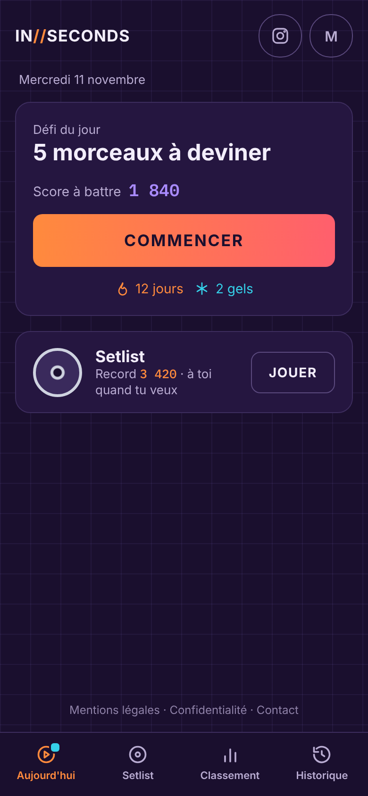 | 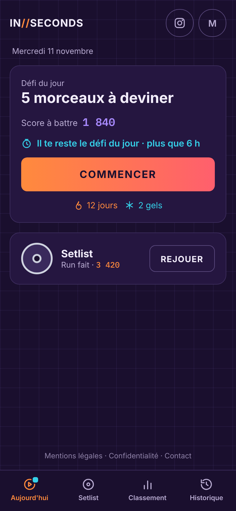 |
| 1. Accueil, première visite | 2. Accueil, retour dans la journée, défi pas fait |
| 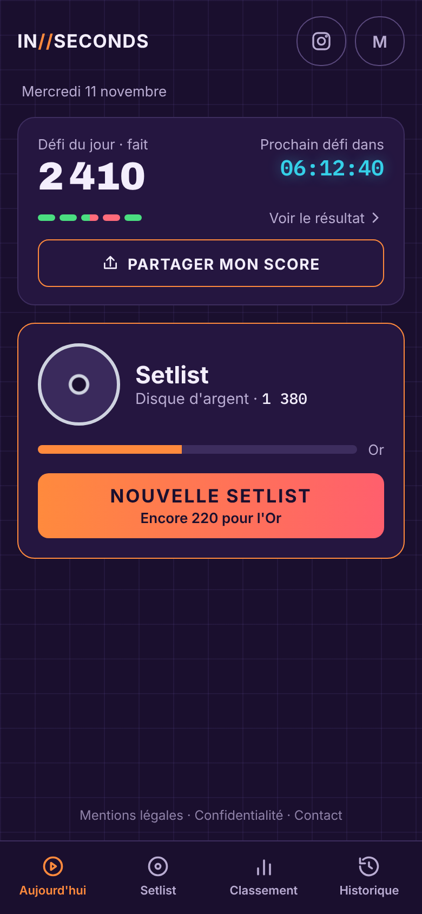 | 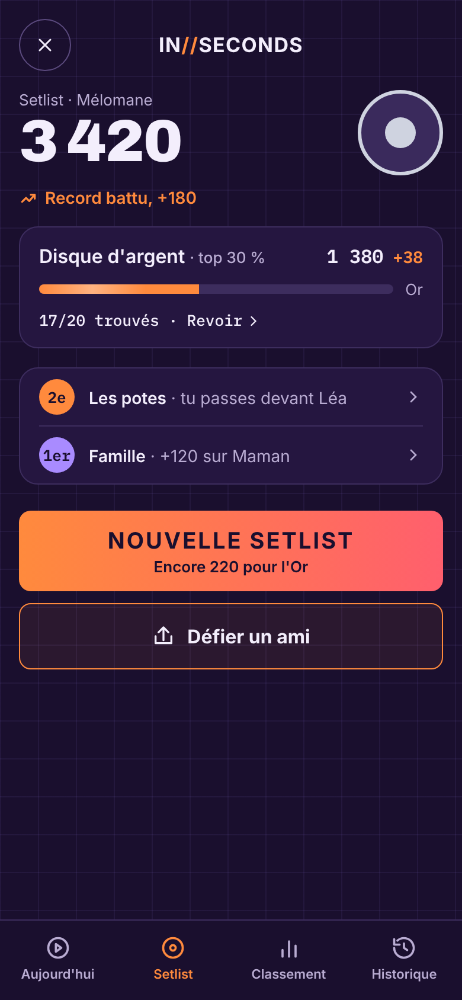 |
| 3. Accueil, défi fait | 4. Fin de run |
| 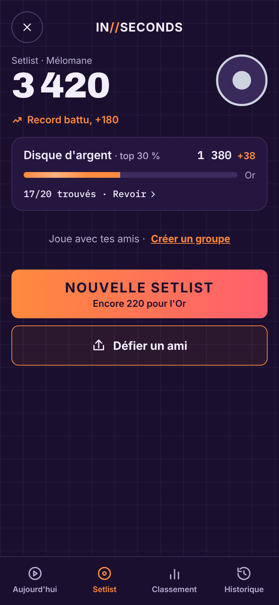 | 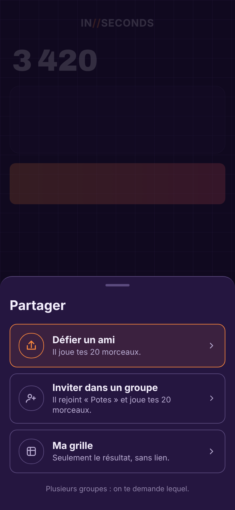 |
| 5. Fin de run sans groupe | 6. Partager |
| 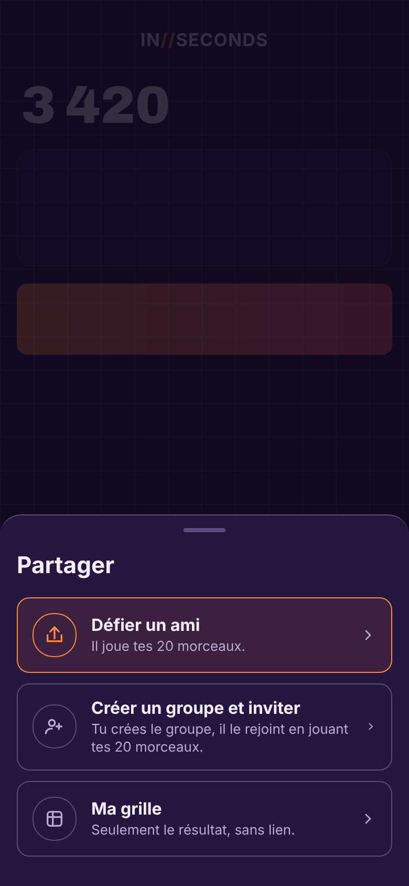 | 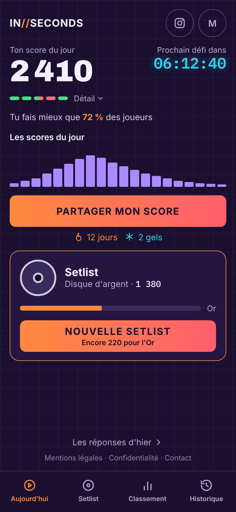 |
| 7. Partager sans groupe | 8. Résultat du Daily |
| 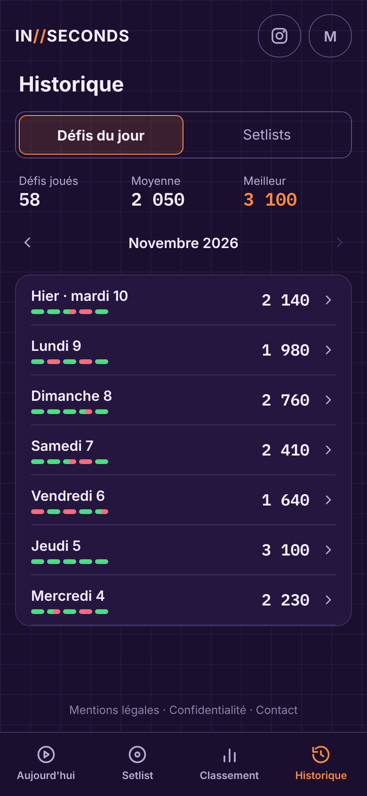 | 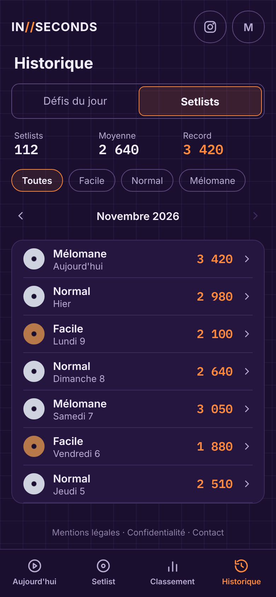 |
| 9. Historique, défis | 10. Historique, setlists |
| 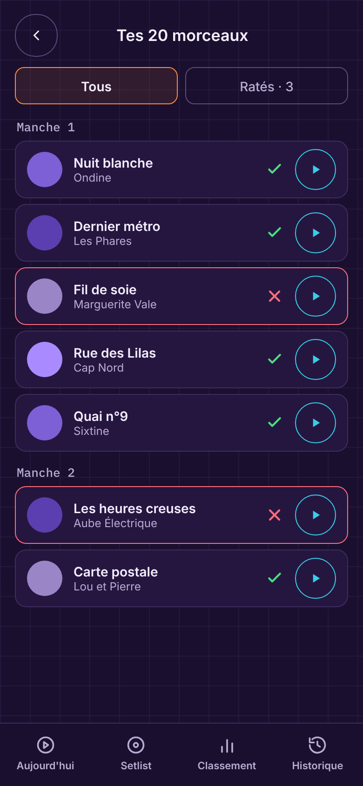 | 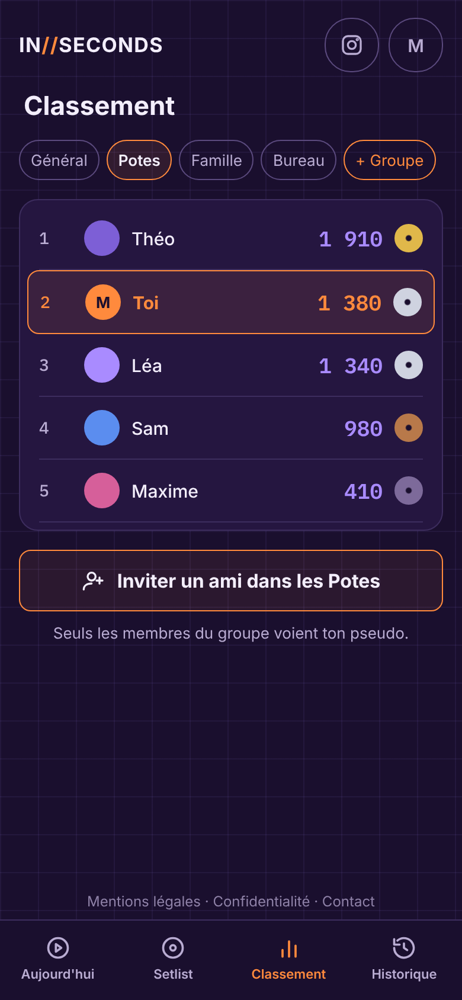 |
| 11. Détail des morceaux (commun aux deux modes) | 12. Classement, un groupe |
| 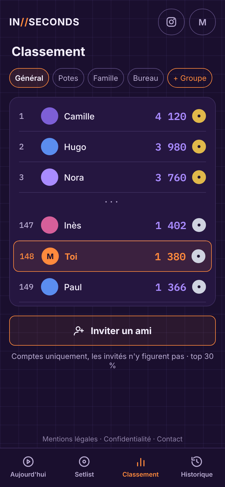 | 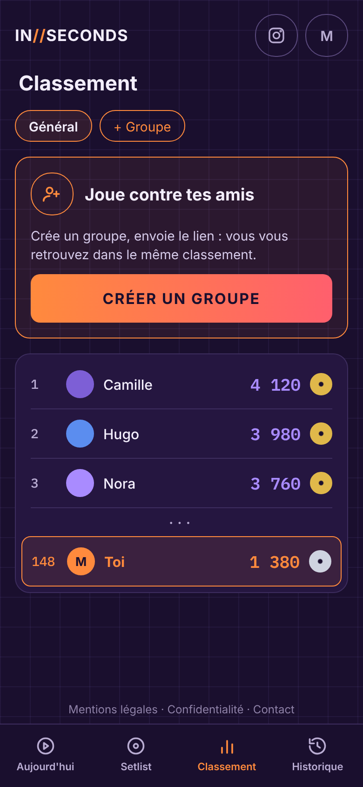 |
| 13. Classement général | 14. Classement sans groupe |
| 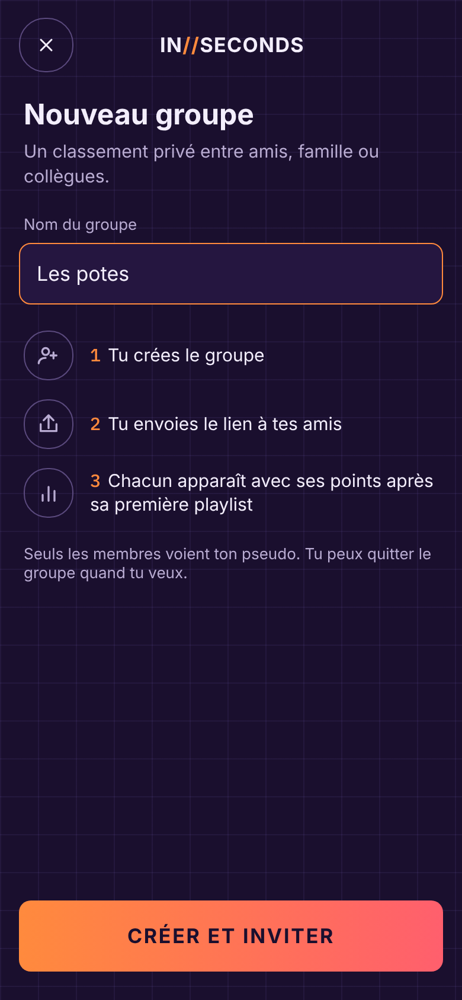 | 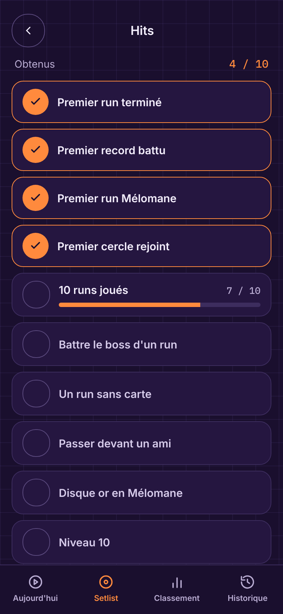 |
| 15. Créer un groupe | 16. Hits |
